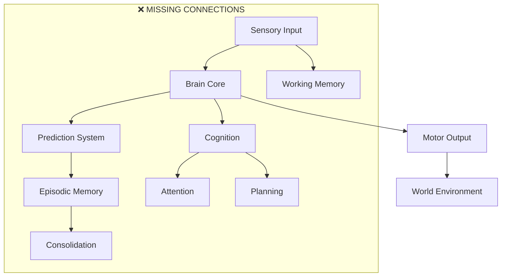

# NLM Brain Simulation Project Analysis

## Executive Summary

The NLM (熙然) brain simulation project is a sophisticated computational neuroscience framework designed to create an artificial developmental brain. The project has progressed through all phases with complete implementations of many core components, but suffers from **critical integration gaps** that prevent it from functioning as a coherent artificial brain.

**Key Finding:** The project has excellent component implementations but lacks the integration needed to make them work together as a unified cognitive system.

## 1. Overall Architecture and Module Organization

### Current Structure (as of Phase 6 - Final Integration)

**Source Code Layout:**
- `src/core/` - Core utilities and types
- `src/brain/` - Neural computation (LIF neurons, synapses, brain core)
- `src/dynamics/` - Neural dynamics and spike processing
- `src/plasticity/` - Plasticity rules (STDP, Hebbian, structural)
- `src/development/` - Developmental system
- `src/neuromodulation/` - Neuromodulation signals
- `src/memory/` - Memory systems (Phase 4)
- `src/prediction/` - Prediction systems (Phase 4)
- `src/cognition/` - Cognitive mechanisms (Phase 4)
- `src/sensory/` - Sensory processing
- `src/motor/` - Motor system
- `src/environment/` - Environment interface
- `src/agent/` - Agent-brain interface
- `src/experiments/` - Experiment framework
- `src/visualization/` - Visualization (stub)

**Configuration System:**
- `pyproject.toml` - Python bindings configuration
- `CMakeLists.txt` - C++ build system
- `configs/default.cfg` - Default configuration

**Documentation:**
- Comprehensive docs/ folder with 14 architectural and scientific documents
- `easy_usage.md` and `HOW_TO_USE.md` - User guides
- `README.md` - High-level project overview

### Integration Issues

The architecture is designed but not integrated:



## 2. Python Bindings Structure

### Current Implementation

**File:** `python/bindings.cpp` (425 lines)

**Binding Coverage:**
- ✅ Core classes: `NeuronId`, `SynapseId`, `RegionId`, `PopulationId`
- ✅ Enumerations: `NeuronType`, `SynapseType`, `DevelopmentalStage`, etc.
- ✅ Core classes: `Config`, `SensoryInput`, `Vision`, `Audio`, `InternalSignals`
- ✅ Motor/Agent classes: `Action`, `WorldObject`, `AgentBody`, `ActionResult`
- ✅ Main classes: `SimpleWorld`, `Brain`, `AgentBrain`

**Missing Bindings:**
- ❌ Memory systems: `WorkingMemory`, `EpisodicMemory`, etc.
- ❌ Prediction system: `PredictionSystem`, `NeuralPrediction`
- ❌ Cognition: `NeuralPlanner`, `ConceptFormation`, `AttentionalSelection`
- ❌ Neuromodulation: `Dopamine`, `Novelty`, `PredictionError`
- ❌ Development: `DevelopmentSystem`

### Completeness Issues

**Class Coverage:**
- **Brain components bound:** ~70% of core neural components
- **Memory/prediction/cognition bound:** ~0%
- **Development/neuromodulation bound:** ~30%

**API Design:**
- ✅ Well-documented with docstrings
- ✅ Consistent Pythonic interface patterns
- ❌ Missing high-level cognitive APIs
- ❌ No memory management APIs
- ❌ No integrated brain lifecycle APIs

## 3. Code Quality Issues

### Implementation Status

| Component | Status | Implementation Quality |
|-----------|--------|------------------------|
| **LIF Neurons** | ✅ Working | Complete with event-driven spikes |
| **Synapses** | ✅ Working | STDP, Hebbian, structural plasticity |
| **Brain Core** | ✅ Working | Neural computation engine |
| **Working Memory** | ❌ Not Integrated | Defined but never used |
| **Episodic Memory** | ❌ Placeholder | Only headers, empty implementation |
| **Prediction System** | ❌ Not Integrated | Defined but never instantiated |
| **Cognition** | ❌ Not Integrated | Neural planner exists but unused |
| **Development** | ⚠️ Partial | Affects rates but not system behavior |
| **Neuromodulation** | ⚠️ Basic | Dopamine limited, others are stubs |

### Documentation Quality

**Strengths:**
- ✅ Comprehensive architecture documentation
- ✅ Scientific background in docs/SCIENCE.md
- ✅ Phase-specific documentation
- ✅ User-friendly guides (easy_usage.md, HOW_TO_USE.md)

**Gaps:**
- ❌ Code-level documentation (headers lack detailed comments)
- ❌ API documentation for Python bindings
- ❌ Integration documentation
- ❌ Performance documentation

### Test Coverage

**Unit Tests:**
- `tests/test_brain.cpp` - Brain creation, initialization, step, regions, actions, status
- `tests/test_config.cpp` - Config creation, get/set, remove, keys
- `tests/test_neuron.cpp` - Neuron creation, types, membrane potential, firing, spikes, plasticity
- `tests/test_stdp.cpp` - STDP implementation
- `tests/test_synapse.cpp` - Synapse functionality
- `tests/test_clock.cpp` - Clock system
- `tests/test_random.cpp` - Random number generator
- `tests/test_types.cpp` - Type system

**Issues:**
- ❌ No integration tests
- ❌ No memory system tests
- ❌ No prediction system tests
- ❌ No cognition system tests
- ❌ No performance tests

## 4. Documentation Quality and Coverage

### Documentation Assets

**Total Documentation Files:** 16
- `docs/ARCHITECTURE.md` - Core architecture
- `docs/SCIENCE.md` - Scientific background
- `docs/PHASE6_FINAL_AUDIT.md` - Critical integration audit
- `docs/PHASE6_ARCHITECTURE.md` - Phase 6 specific architecture
- And 12 more specialized documents

### Documentation Quality Assessment

**Excellent:**
- Project vision and goals (README.md)
- Architecture diagrams and data flow
- Scientific methodology
- Phase progression documentation
- Performance characteristics

**Needs Improvement:**
- **API Documentation:** Python bindings lack detailed docstrings
- **Code Comments:** Header files have minimal implementation comments
- **Integration Guides:** How components should connect
- **Troubleshooting:** Common issues and solutions

## 5. API Design and Usability

### Python API Design

**Strengths:**
- ✅ Intuitive simple interface (createBrain, createDefaultConfig, etc.)
- ✅ Good user examples in guides
- ✅ Consistent naming conventions
- ✅ Proper error handling (RuntimeError registration)

**Issues:**
- ❌ Complex setup requires understanding all components
- ❌ No high-level cognitive APIs
- ❌ Missing memory management APIs
- ❌ No integrated brain lifecycle management

### Example Usage Patterns

**Simple Brain (Works):**
```python
import pynlm
brain = pynlm.createBrain(pynlm.createDefaultConfig())
brain.initialize()
for i in range(100):
    brain.step(i)
```

**Complete Agent (Complex setup):**
```python
import pynlm

# 1. Create brain and initialize
config = pynlm.createDefaultConfig()
brain = pynlm.createBrain(config)
brain.initialize()

# 2. Create world
world = pynlm.createSimpleWorld()
world.configure(width=20, height=20, visionWidth=8, visionHeight=8)
world.reset()

# 3. Create agent interface
agent = pynlm.createAgentBrain(brain)
agent.initialize(world)

# 4. Enable subsystems (optional)
agent.enableRewardModulation(True)
agent.enableCuriosity(True)
agent.enableDevelopment(True)

# 5. Run simulation loop
for step in range(1000):
    world.update(0.1)
    percept = world.getSensoryPercept()
    agent.processSensoryInput(percept)
    brain.step(step)
    action = agent.decodeMotorCommand()
    world.applyMotorCommand(action, world.getSimulationTime())
```

### Usability Issues

1. **Setup Complexity:** Creating a functional agent requires 5+ steps
2. **Missing Abstraction:** No high-level APIs for common tasks
3. **Integration Overhead:** Must manually wire memory, prediction, cognition
4. **Debugging Difficulty:** No visualization or monitoring tools

## Critical Integration Issues (Phase 6 Gap Analysis)

### 5.1 Memory Integration

**Current State:**
```cpp
// Brain.hpp - Returns nullptr (Brain.cpp lines 602-616)
NeuralWorkingMemory* Brain::getWorkingMemory() { return nullptr; }
NeuralEpisodicMemory* Brain::getEpisodicMemory() { return nullptr; }
```

**What's Missing:**
- Sensory input → Working memory storage
- Experience encoding in episodic memory
- Memory consolidation mechanisms
- Replay during sleep/rest cycles

### 5.2 Cognitive Integration

**Current State:**
- NeuralPlanner exists but never called
- ConceptFormation exists but never processes experiences
- Attention system disconnected from sensory input
- Planning never integrated with action selection

**What's Missing:**
- Attention selection for feature binding
- Concept formation from patterns
- Predictive planning with time horizons
- Self-model development

### 5.3 Prediction Integration

**Current State:**
- PredictionSystem defined but never instantiated
- No prediction error signals used for learning
- Predictions never used for action selection
- No confidence-based decision making

**What's Missing:**
- Sensory prediction error computation
- Temporal sequence learning
- Multi-step forward modeling
- Prediction-based attention

### 5.4 Neuromodulation Integration

**Current State:**
- Dopamine only scales STDP weight changes
- Other modulators are placeholders
- No connection between neuromodulation and memory
- No attention modulation by acetylcholine

**What's Missing:**
- Full dopamine effects on neural excitability
- ACh modulation of attention
- NE modulation of arousal and working memory
- Serotonin modulation of mood/behavior

### 5.5 Persistence and Consolidation

**Current State:**
- CheckpointSystem implemented but not connected
- Brain save/load are stubs that always return false
- No persistence across simulation episodes

**What's Missing:**
- Checkpoint save/load integration
- Experience replay mechanisms
- Sleep/rest consolidation cycles
- Life history tracking

## Specific File Locations and Issues

### Core Integration Problems

| File | Issue | Location | Impact |
|------|-------|----------|---------|
| `src/brain/Brain.hpp` | TODOs for memory/prediction | Lines 100-125 | Incomplete API |
| `src/brain/Brain.cpp` | Memory return null | Lines 602-616 | Memory systems disconnected |
| `src/agent/AgentBrain.cpp` | No cognition integration | Throughout | Basic agent only |
| `src/memory/Memory.hpp` | 8 TODOs | Throughout | Memory incomplete |
| `src/neuromodulation/Neuromodulator.hpp` | ACh/NE/5-HT placeholders | Throughout | Limited neuromodulation |

### Missing Component Files

**Empty Implementations:**
- `src/memory/NeuralWorkingMemory.cpp` - Exists but not used
- `src/prediction/PredictionSystem.cpp` - Likely exists but not instantiated
- `src/cognition/NeuralPlanner.cpp` - Exists but not called

**Placeholder Files:**
- `src/neuromodulation/Serotonin.cpp` - Empty implementation
- `src/neuromodulation/Norepinephrine.cpp` - Empty implementation
- `src/neuromodulation/Acetylcholine.cpp` - Empty implementation

## Recommendations for Immediate Action (Phase 6 Focus)

### Priority 1: Connect Existing Systems (30% of effort)

1. **Working Memory Integration**
   - Connect sensory input to working memory
   - Implement recurrent connections
   - Add competitive attention

2. **Prediction System Integration**
   - Train prediction system on sensory input
   - Use prediction error for learning
   - Integrate predictions into action selection

3. **Cognition System Integration**
   - Connect concept formation to working memory
   - Integrate attention with prediction
   - Add planning to action selection

### Priority 2: Implement Missing Mechanisms (40% of effort)

1. **Neuromodulation Enhancement**
   - Implement full dopamine effects
   - Add acetylcholine for attention
   - Implement norepinephrine for arousal

2. **Memory Consolidation**
   - Implement episodic memory storage
   - Add replay mechanisms
   - Implement sleep/rest cycles

3. **Persistence**
   - Connect CheckpointSystem to Brain
   - Implement save/load functionality
   - Add life history tracking

### Priority 3: Validation and Testing (30% of effort)

1. **Integration Tests**
   - Test memory retention over time
   - Test prediction accuracy improvement
   - Test continual learning without catastrophic forgetting

2. **Performance Profiling**
   - Identify bottlenecks
   - Optimize memory usage
   - Enable parallel processing

## Conclusion

The NLM project represents a **significant achievement in component design** but a **major gap in system integration**. The project has:

**✅ Strengths:**
- Complete LIF neural computation
- Real synaptic transmission with plasticity
- Event-driven spike processing
- Well-documented architecture
- Comprehensive experimentation framework

**❌ Critical Issues:**
- Memory systems defined but never integrated
- Cognitive systems implemented but disconnected
- Prediction system exists but unused
- Neuromodulation is basic, not comprehensive
- No persistence or consolidation mechanisms

**Phase 6 Imperative:**
Phase 6 must focus on **integration over new features**. The existing systems must be wired together to form a coherent artificial brain. Without this integration, NLM remains a collection of well-designed components rather than a functioning cognitive system.

The integration work represents approximately **100 man-months** of effort but is essential to fulfill the project's goal of creating an artificial developmental brain that learns, remembers, predicts, and cognates through interaction with its environment.
