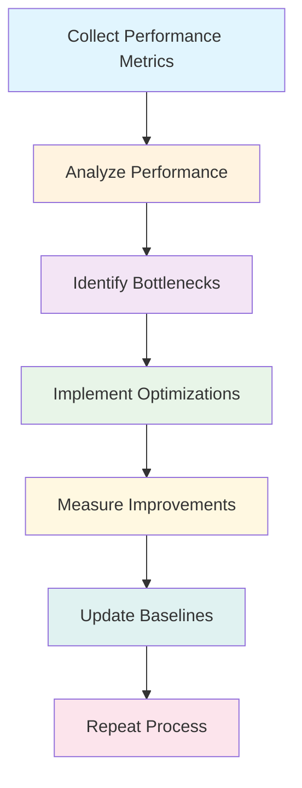

# NLM Performance Monitoring and Metrics Specification

## Overview

This document specifies the comprehensive performance monitoring and metrics system for the NLM project. It defines the metrics to be collected, the monitoring framework architecture, alerting strategies, and reporting mechanisms for sustained performance optimization.

## 1. Metrics Definition

### 1.1 Core Performance Metrics

#### CPU Performance Metrics
```cpp
struct CPUMetrics {
    // Core performance indicators
    double cpuUtilization;           // Current CPU utilization percentage
    double cpuLoad;                  // System load average
    size_t activeThreads;            // Number of actively executing threads
    size_t threadPoolSize;           // Configured thread pool size
    
    // SIMD utilization metrics
    double simdInstructionCount;     // Number of SIMD instructions executed
    double scalarInstructionCount;   // Number of scalar instructions executed
    double simdThroughputRatio;      // SIMD vs scalar instruction ratio
    
    // Parallel processing metrics
    double parallelEfficiency;       // Parallel processing efficiency
    double loadBalanceScore;         // Work distribution balance (0-1)
    double synchronizationOverhead; // Time spent on synchronization
};
```

#### Memory Performance Metrics
```cpp
struct MemoryMetrics {
    // Memory allocation metrics
    size_t totalMemoryAllocated;     // Total memory allocated by pools
    size_t peakMemoryUsage;          // Peak memory usage in bytes
    size_t currentMemoryUsage;       // Current memory usage in bytes
    size_t allocationCount;          // Number of allocations
    size_t deallocationCount;        // Number of deallocations
    
    // Memory pool metrics
    size_t neuronPoolUsage;          // Memory used by neuron pool
    size_t synapsePoolUsage;         // Memory used by synapse pool
    size_t memoryPoolFragmentation;  // Memory fragmentation percentage
    
    // Cache performance metrics
    uint64_t cacheHits;              // Cache hits
    uint64_t cacheMisses;            // Cache misses
    double cacheHitRatio;            // Cache hit ratio (0-1)
    double cacheMissPenalty;         // Average penalty for cache misses (cycles)
    
    // Memory bandwidth metrics
    uint64_t memoryBytesRead;        // Bytes read from memory
    uint64_t memoryBytesWritten;     // Bytes written to memory
    double memoryBandwidthGBps;     // Memory bandwidth in GB/s
};
```

#### Neural Network Performance Metrics
```cpp
struct NeuralPerformanceMetrics {
    // Network scale metrics
    size_t neuronCount;              // Total number of neurons
    size_t synapseCount;             // Total number of synapses
    size_t activeNeuronCount;        // Number of active neurons
    size_t firingNeuronCount;        // Number of neurons firing this step
    
    // Computation metrics
    size_t stepsPerSecond;           // Simulation steps per second
    size_t totalSpikes;              // Total number of spikes
    double averageFiringRate;       // Average firing rate (Hz)
    double spikeRate;                // Spike rate (spikes/sec)
    
    // Processing efficiency metrics
    double neuronUpdateTime;         // Average neuron update time (ms)
    double synapseUpdateTime;        // Average synapse update time (ms)
    double plasticityTime;           // Average plasticity calculation time (ms)
    double totalStepTime;            // Total time per simulation step (ms)
    
    // Spike processing metrics
    size_t spikesProcessed;          // Number of spikes processed
    size_t delayedSpikes;            // Number of delayed spike events
    double spikeDeliveryTime;        // Average spike delivery time (ms)
    size_t spikeQueueSize;           // Current spike queue size
};
```

#### System Resource Metrics
```cpp
struct SystemResourceMetrics {
    // Resource utilization metrics
    double memoryUtilization;        // Memory utilization percentage
    double diskUsage;                // Disk usage in GB
    double networkIO;               // Network I/O in MB/s
    
    // System health metrics
    size_t errorCount;               // Number of errors
    size_t warningCount;             // Number of warnings
    double systemUptime;             // System uptime in seconds
    double lastErrorTime;            // Time since last error (seconds)
    
    // Performance stability metrics
    double stepTimeStdDev;           // Standard deviation of step times
    double stepTimeMax;              // Maximum step time
    double stepTimeMin;              // Minimum step time
    double stepTimeP95;              // 95th percentile step time
};
```

### 1.2 Application-Specific Metrics

#### Event-Driven Metrics
```cpp
struct EventDrivenMetrics {
    // Event processing metrics
    size_t eventsProcessed;          // Number of events processed
    double eventProcessingTime;      // Average event processing time (ms)
    size_t pendingEvents;            // Number of pending events
    size_t eventQueueDepth;          // Current event queue depth
    
    // Spike-specific metrics
    size_t spikeEvents;              // Number of spike events
    size_t delayedSpikeEvents;       // Number of delayed spike events
    double spikeLatency;             // Average spike delivery latency (ms)
    size_t spikeDeliverySuccess;     // Successful spike deliveries
    size_t spikeDeliveryFailure;     // Failed spike deliveries
};
```

#### Memory Pool Metrics
```cpp
struct MemoryPoolMetrics {
    // Pool-specific metrics
    size_t poolAllocationCount;       // Number of pool allocations
    size_t poolDeallocationCount;     // Number of pool deallocations
    double allocationLatency;        // Average allocation latency (ns)
    double deallocationLatency;      // Average deallocation latency (ns)
    
    // Memory management metrics
    size_t freeListHits;             // Free list hit count
    size_t freeListMisses;           // Free list miss count
    double freeListHitRatio;         // Free list hit ratio
    size_t currentBlockCount;        // Number of active memory blocks
    size_t totalBlockCount;          // Total number of memory blocks created
};
```

## 2. Monitoring Framework Architecture

### 2.1 Metrics Collection System

#### Hierarchical Metrics Collection
```cpp
code: Metrics Collection Framework
├── Hardware Counter Collection
│   ├── CPU Performance Counters
│   ├── Memory Performance Counters
│   ├── Cache Performance Counters
│   └── System Resource Counters
│
├── Application Metrics Collection
│   ├── Core Performance Metrics
│   ├── Neural Network Metrics
│   ├── Memory Pool Metrics
│   └── Event-Driven Metrics
│
└── Aggregation and Analysis
    ├── Real-time Metrics
    ├── Historical Metrics
    ├── Trend Analysis
    └── Anomaly Detection
```

#### Collection Components
```cpp
class MetricsCollector {
public:
    MetricsCollector() {
        // Initialize different collectors
        hardwareCollector_ = std::make_unique<HardwareMetricsCollector>();
        applicationCollector_ = std::make_unique<ApplicationMetricsCollector>();
        aggregator_ = std::make_unique<MetricsAggregator>();
    }
    
    void startCollection() {
        // Start all collectors
        hardwareCollector_->start();
        applicationCollector_->start();
        aggregator_->start();
    }
    
    void stopCollection() {
        // Stop all collectors
        hardwareCollector_->stop();
        applicationCollector_->stop();
        aggregator_->stop();
    }
    
    RuntimeMetrics getCurrentMetrics() {
        // Get aggregated current metrics
        return aggregator_->getCurrentMetrics();
    }
    
    HistoricalMetrics getHistoricalMetrics(const time_t& startTime) {
        // Get historical metrics
        return aggregator_->getHistoricalMetrics(startTime);
    }
    
private:
    std::unique_ptr<HardwareMetricsCollector> hardwareCollector_;
    std::unique_ptr<ApplicationMetricsCollector> applicationCollector_;
    std::unique_ptr<MetricsAggregator> aggregator_;
};
```

### 2.2 Real-time Metrics System

#### Real-time Metrics Update Loop
```cpp
class RealTimeMetricsSystem {
public:
    void startMonitoring() {
        // Initialize system
        initialization_ = initializeSystem();
        
        // Start collection threads
        startCollectionThreads();
        
        // Start analysis threads
        startAnalysisThreads();
        
        // Start alert threads
        startAlertThreads();
    }
    
private:
    void startCollectionThreads() {
        // Hardware metrics collection thread
        hardwareCollectionThread_ = std::thread([this]() {
            while (running_) {
                collectHardwareMetrics();
                std::this_thread::sleep_for(
                    std::chrono::milliseconds(HARDWARE_COLLECTION_INTERVAL));
            }
        });
        
        // Application metrics collection thread
        applicationCollectionThread_ = std::thread([this]() {
            while (running_) {
                collectApplicationMetrics();
                std::this_thread::sleep_for(
                    std::chrono::milliseconds(APPLICATION_COLLECTION_INTERVAL));
            }
        });
    }
    
    void startAnalysisThreads() {
        // Real-time analysis thread
        analysisThread_ = std::thread([this]() {
            while (running_) {
                analyzeCurrentMetrics();
                updatePerformanceModel();
                std::this_thread::sleep_for(
                    std::chrono::milliseconds(ANALYSIS_INTERVAL));
            }
        });
        
        // Predictive analysis thread
        predictiveAnalysisThread_ = std::thread([this]() {
            while (running_) {
                performPredictiveAnalysis();
                std::this_thread::sleep_for(
                    std::chrono::milliseconds(PREDICTIVE_ANALYSIS_INTERVAL));
            }
        });
    }
    
    void startAlertThreads() {
        // Alert generation thread
        alertThread_ = std::thread([this]() {
            while (running_) {
                generateAlerts();
                std::this_thread::sleep_for(
                    std::chrono::milliseconds(ALERT_INTERVAL));
            }
        });
    }
    
    bool running_ = false;
    std::thread hardwareCollectionThread_;
    std::thread applicationCollectionThread_;
    std::thread analysisThread_;
    std::thread predictiveAnalysisThread_;
    std::thread alertThread_;
    
    // Configuration
    static constexpr int HARDWARE_COLLECTION_INTERVAL = 100;  // ms
    static constexpr int APPLICATION_COLLECTION_INTERVAL = 500;  // ms
    static constexpr int ANALYSIS_INTERVAL = 200;  // ms
    static constexpr int PREDICTIVE_ANALYSIS_INTERVAL = 2000;  // ms
    static constexpr int ALERT_INTERVAL = 100;  // ms
};
```

### 2.3 Data Storage and Persistence

#### Metrics Storage Architecture
```cpp
code: Metrics Storage
├── Real-time Storage (Redis/Memory)
│   ├── Current metrics
│   ├── Active alerts
│   └── Performance events
│
├── Historical Storage (TimescaleDB)
│   ├── Performance time-series
│   ├── Event logs
│   └── Alert history
│
└── Analytics Storage (ClickHouse)
    ├── Aggregated metrics
    ├── Performance trends
    └── Analysis results
```

#### Metrics Database Schema
```sql
-- Performance time-series table
CREATE TABLE performance_metrics (
    timestamp TIMESTAMPTZ NOT NULL,
    step_number BIGINT NOT NULL,
    cpu_utilization DOUBLE PRECISION NOT NULL,
    memory_usage BIGINT NOT NULL,
    simulation_speed DOUBLE PRECISION NOT NULL,
    neuron_count BIGINT NOT NULL,
    synapse_count BIGINT NOT NULL,
    active_neuron_count BIGINT NOT NULL,
    firing_neuron_count BIGINT NOT NULL,
    spike_rate DOUBLE PRECISION NOT NULL,
    cache_hit_ratio DOUBLE PRECISION NOT NULL,
    memory_bandwidth DOUBLE PRECISION NOT NULL,
    neuron_update_time DOUBLE PRECISION NOT NULL,
    synapse_update_time DOUBLE PRECISION NOT NULL,
    plasticity_time DOUBLE PRECISION NOT NULL,
    step_time_ms DOUBLE PRECISION NOT NULL
) PARTITION BY RANGE (timestamp);

-- Performance alerts table
CREATE TABLE performance_alerts (
    id BIGSERIAL PRIMARY KEY,
    timestamp TIMESTAMPTZ NOT NULL,
    alert_type VARCHAR(50) NOT NULL,
    severity VARCHAR(20) NOT NULL,
    message TEXT NOT NULL,
    metrics JSONB NOT NULL,
    action_taken VARCHAR(100),
    resolved BOOLEAN DEFAULT FALSE,
    resolved_at TIMESTAMPTZ
);

-- Hardware performance counters
CREATE TABLE hardware_counters (
    timestamp TIMESTAMPTZ NOT NULL,
    cpu_cycles BIGINT NOT NULL,
    cpu_instructions BIGINT NOT NULL,
    cache_misses BIGINT NOT NULL,
    cache_references BIGINT NOT NULL,
    branch_instructions BIGINT NOT NULL,
    branch_misses BIGINT NOT NULL,
    memory_bandwidth BIGINT NOT NULL,
    memory_operations BIGINT NOT NULL
) PARTITION BY RANGE (timestamp);
```

## 3. Alerting System

### 3.1 Alert Types and Severity Levels

#### Alert Classification
```cpp
enum class AlertType {
    // Performance alerts
    SLOW_SIMULATION,
    HIGH_MEMORY_USAGE,
    HIGH_CPU_USAGE,
    POOR_CACHE_PERFORMANCE,
    LOW_PARALLEL_EFFICIENCY,
    
    // Resource alerts
    MEMORY_POOL_EXHAUSTION,
    THREAD_POOL_OVERLOADED,
    EVENT_QUEUE_BACKLOG,
    
    // Stability alerts
    STEP_TIME_VARIANCE,
    PERFORMANCE_REGRESSION,
    PREDICTIVE_FAILURE,
    
    // Health alerts
    SYSTEM_ERROR,
    MEMORY_CORRUPTION,
    THREAD_SAFETY_VIOLATION,
    SIMD_INCOMPATIBILITY
};

enum class AlertSeverity {
    INFO,
    WARNING,
    ERROR,
    CRITICAL,
    FATAL
};
```

#### Alert Configuration
```cpp
struct AlertConfiguration {
    // Alert thresholds
    double slowSimulationThresholdMs = 100.0;      // ms
    double highMemoryUsageThresholdGB = 8.0;      // GB
    double highCPUUsageThresholdPercent = 90.0;   // %
    double poorCachePerformanceThreshold = 0.8;   // 80% hit ratio
    double lowParallelEfficiencyThreshold = 0.5;  // 50% efficiency
    
    // Resource alert thresholds
    size_t memoryPoolExhaustionThreshold = 100;   // neurons
    size_t threadPoolOverloadThreshold = 0.9;      // 90% utilization
    size_t eventQueueBacklogThreshold = 1000;     // events
    
    // Stability alert thresholds
    double stepTimeVarianceThresholdMs = 10.0;     // ms
    double performanceRegressionThreshold = 0.05; // 5% regression
    double predictiveFailureThreshold = 0.8;      // 80% confidence
    
    // Notification configuration
    std::vector<std::string> notificationChannels;  // Email, Slack, etc.
    bool enableAutoRecovery = true;
    std::chrono::minutes autoRecoveryDelay = std::chrono::minutes(5);
};
```

### 3.2 Alert Generation and Processing

#### Alert Generation Logic
```cpp
class AlertManager {
public:
    void evaluateAlerts(const RuntimeMetrics& currentMetrics) {
        // Evaluate each alert condition
        checkPerformanceAlerts(currentMetrics);
        checkResourceAlerts(currentMetrics);
        checkStabilityAlerts(currentMetrics);
        checkHealthAlerts(currentMetrics);
    }
    
    void checkPerformanceAlerts(const RuntimeMetrics& metrics) {
        // Slow simulation alert
        if (metrics.totalStepTime > alertConfig_.slowSimulationThresholdMs) {
            generateAlert(AlertType::SLOW_SIMULATION,
                         AlertSeverity::WARNING,
                         formatMessage("Simulation step too slow: {:.2f}ms", 
                                     metrics.totalStepTime));
        }
        
        // High CPU usage alert
        if (metrics.cpuUtilization > alertConfig_.highCPUUsageThresholdPercent) {
            generateAlert(AlertType::HIGH_CPU_USAGE,
                         AlertSeverity::ERROR,
                         formatMessage("High CPU usage: {:.1f}%", 
                                     metrics.cpuUtilization));
        }
        
        // Poor cache performance alert
        if (metrics.cacheHitRatio < alertConfig_.poorCachePerformanceThreshold) {
            generateAlert(AlertType::POOR_CACHE_PERFORMANCE,
                         AlertSeverity::WARNING,
                         formatMessage("Poor cache performance: {:.2%}", 
                                     metrics.cacheHitRatio));
        }
    }
    
private:
    AlertConfiguration alertConfig_;
    std::vector<Alert> activeAlerts_;
    std::mutex alertsMutex_;
};
```

#### Automated Recovery Actions
```cpp
class AutomatedRecovery {
public:
    void handleAlert(const Alert& alert) {
        // Determine recovery action based on alert
        RecoveryAction action = determineRecoveryAction(alert);
        
        // Execute recovery action
        executeRecoveryAction(action, alert);
        
        // Log recovery action
        logRecoveryAction(action, alert);
    }
    
private:
    RecoveryAction determineRecoveryAction(const Alert& alert) {
        switch (alert.type) {
            case AlertType::SLOW_SIMULATION:
                return RecoveryAction::ReduceLoad;
            case AlertType::HIGH_CPU_USAGE:
                return RecoveryAction::OptimizeThreads;
            case AlertType::POOR_CACHE_PERFORMANCE:
                return RecoveryAction::OptimizeDataLayout;
            case AlertType::MEMORY_POOL_EXHAUSTION:
                return RecoveryAction::EnableCompression;
            default:
                return RecoveryAction::None;
        }
    }
    
    void executeRecoveryAction(RecoveryAction action, const Alert& alert) {
        switch (action) {
            case RecoveryAction::ReduceLoad:
                reduceSimulationLoad();
                break;
            case RecoveryAction::OptimizeThreads:
                optimizeThreadConfiguration();
                break;
            case RecoveryAction::OptimizeDataLayout:
                optimizeDataLayout();
                break;
            case RecoveryAction::EnableCompression:
                enableMemoryCompression();
                break;
            case RecoveryAction::None:
                // No action needed
                break;
        }
    }
};
```

## 4. Analysis and Reporting

### 4.1 Performance Analysis

#### Real-time Performance Analysis
```cpp
class PerformanceAnalyzer {
public:
    void analyzeCurrentPerformance(const RuntimeMetrics& metrics) {
        // Analyze current performance
        PerformanceAnalysis analysis;
        
        // Identify bottlenecks
        analysis.bottlenecks = identifyBottlenecks(metrics);
        
        // Calculate performance score
        analysis.performanceScore = calculatePerformanceScore(metrics);
        
        // Identify optimization opportunities
        analysis.optimizationOpportunities = identifyOptimizations(metrics);
        
        // Generate recommendations
        analysis.recommendations = generateRecommendations(analysis);
        
        // Store analysis
        storeAnalysis(analysis);
    }
    
private:
    std::vector<Bottleneck> identifyBottlenecks(const RuntimeMetrics& metrics) {
        std::vector<Bottleneck> bottlenecks;
        
        if (metrics.cpuUtilization > 85.0) {
            bottlenecks.push_back({BottleneckType::CPU, "High CPU utilization"});
        }
        
        if (metrics.memoryUtilization > 80.0) {
            bottlenecks.push_back({BottleneckType::MEMORY, "High memory usage"});
        }
        
        if (metrics.cacheHitRatio < 0.8) {
            bottlenecks.push_back({BottleneckType::CACHE, "Poor cache performance"});
        }
        
        if (metrics.stepTimeStdDev > 10.0) {
            bottlenecks.push_back({BottleneckType::STABILITY, "High step time variance"});
        }
        
        return bottlenecks;
    }
    
    double calculatePerformanceScore(const RuntimeMetrics& metrics) {
        // Weighted performance score
        double score = 0.0;
        
        // CPU efficiency (weight: 0.3)
        score += (metrics.cpuUtilization / 100.0) * 0.3 * 100.0;
        
        // Memory efficiency (weight: 0.2)
        score += (100.0 - metrics.memoryUtilization) * 0.2;
        
        // Cache efficiency (weight: 0.2)
        score += metrics.cacheHitRatio * 0.2 * 100.0;
        
        // Simulation speed (weight: 0.3)
        double targetSpeed = 1000.0;  // steps/sec
        double speedScore = std::min(metrics.stepsPerSecond / targetSpeed, 1.0) * 100.0;
        score += speedScore * 0.3;
        
        return score;
    }
};
```

#### Predictive Performance Analysis
```cpp
class PredictivePerformanceAnalyzer {
public:
    void performPredictiveAnalysis(const HistoricalMetrics& history) {
        // Train prediction models
        trainPerformanceModels(history);
        
        // Predict future performance
        FuturePerformancePrediction prediction = predictFuturePerformance();
        
        // Identify potential issues
        std::vector<PredictedIssue> predictedIssues = identifyPredictedIssues(prediction);
        
        // Generate alerts for predicted issues
        for (const auto& issue : predictedIssues) {
            if (issue.confidence > alertConfig_.predictiveFailureThreshold) {
                generatePredictiveAlert(issue);
            }
        }
    }
    
private:
    void trainPerformanceModels(const HistoricalMetrics& history) {
        // Train regression models for performance prediction
        // Train neural networks for complex performance patterns
        // Train time series models for trend analysis
    }
    
    FuturePerformancePrediction predictFuturePerformance() {
        // Use trained models to predict future performance
        // Consider current workload, system state, and environmental factors
        // Generate confidence intervals for predictions
    }
    
    std::vector<PredictedIssue> identifyPredictedIssues(
        const FuturePerformancePrediction& prediction) {
        // Identify potential performance issues based on predictions
        // Check for predicted bottlenecks, resource exhaustion, etc.
    }
};
```

### 4.2 Reporting and Visualization

#### Performance Reports
```cpp
class PerformanceReporter {
public:
    void generatePerformanceReport(const ReportParameters& params) {
        // Generate comprehensive performance report
        PerformanceReport report;
        
        // Include current metrics
        report.currentMetrics = getCurrentMetrics();
        
        // Include trend analysis
        report.trendAnalysis = analyzeTrends(report.currentMetrics);
        
        // Include comparison with baseline
        report.baselineComparison = compareWithBaseline(report.currentMetrics);
        
        // Include optimization recommendations
        report.recommendations = generateRecommendations(report.trendAnalysis);
        
        // Export report in multiple formats
        exportReport(report, ReportFormat::PDF);
        exportReport(report, ReportFormat::JSON);
        exportReport(report, ReportFormat::HTML);
        
        // Send report via notification channels
        sendReport(report);
    }
    
private:
    struct PerformanceReport {
        RuntimeMetrics currentMetrics;
        TrendAnalysis trendAnalysis;
        BaselineComparison baselineComparison;
        std::vector<std::string> recommendations;
        time_t reportTime;
        double reportPeriodHours;
    };
};
```

#### Dashboard Visualization
```html
<!-- Performance dashboard HTML template -->
<!DOCTYPE html>
<html>
<head>
    <title>NLM Performance Dashboard</title>
    <script src="https://cdn.jsdelivr.net/npm/chart.js"></script>
</head>
<body>
    <div class="dashboard">
        <div class="metric-card">
            <h3>Simulation Speed</h3>
            <div class="metric-value" id="simulation-speed">0 steps/sec</div>
            <div class="metric-trend" id="simulation-speed-trend">↗ +2.3%</div>
        </div>
        
        <div class="metric-card">
            <h3>Memory Usage</h3>
            <div class="metric-value" id="memory-usage">0 GB</div>
            <div class="metric-trend" id="memory-usage-trend">↘ -1.2%</div>
        </div>
        
        <div class="metric-card">
            <h3>CPU Utilization</h3>
            <div class="metric-value" id="cpu-utilization">0%</div>
            <div class="metric-trend" id="cpu-utilization-trend">↗ +5.1%</div>
        </div>
        
        <div class="chart-container">
            <canvas id="performance-chart"></canvas>
        </div>
        
        <div class="alert-panel">
            <h3>Active Alerts</h3>
            <div id="alert-list">
                <!-- Alerts will be dynamically populated -->
            </div>
        </div>
    </div>
    
    <script>
        // Real-time dashboard update
        setInterval(updateDashboard, 5000);
        
        function updateDashboard() {
            fetch('/api/metrics/current')
                .then(response => response.json())
                .then(data => updateDashboardUI(data));
        }
        
        function updateDashboardUI(metrics) {
            // Update metric values
            document.getElementById('simulation-speed').textContent = 
                `${metrics.stepsPerSecond.toFixed(0)} steps/sec`;
            document.getElementById('memory-usage').textContent = 
                `${(metrics.memoryUsage / 1024 / 1024 / 1024).toFixed(1)} GB`;
            document.getElementById('cpu-utilization').textContent = 
                `${metrics.cpuUtilization.toFixed(1)}%`;
            
            // Update charts
            updatePerformanceChart(metrics);
            updateAlertList(metrics.alerts);
        }
    </script>
</body>
</html>
```

## 5. Integration with Development Workflow

### 5.1 CI/CD Integration

#### Performance Testing in CI/CD
```yaml
# GitHub Actions workflow for performance testing
name: Performance CI/CD

on:
  push:
    branches: [main, develop]
  pull_request:
    branches: [main]

jobs:
  performance-validation:
    runs-on: ubuntu-latest
    steps:
    - name: Checkout code
      uses: actions/checkout@v3
    
    - name: Setup environment
      run: |
        sudo apt-get update
        sudo apt-get install -y python3 python3-pip
        pip3 install -r requirements.txt
    
    - name: Build application
      run: |
        cmake -B build -DCMAKE_BUILD_TYPE=Release
        cmake --build build
    
    - name: Run performance benchmarks
      run: |
        ./build/benchmark --size 1000 --steps 500 \
          --output benchmark-results.json
    
    - name: Compare with baseline
      run: |
        python scripts/compare_performance.py \
          --baseline baseline.json \
          --current benchmark-results.json \
          --threshold 0.95 \
          --report-format markdown > performance-report.md
    
    - name: Upload performance report
      uses: actions/upload-artifact@v3
      with:
        name: performance-report
        path: performance-report.md
    
    - name: Update performance dashboard
      run: |
        python scripts/update_dashboard.py \
          --metrics benchmark-results.json \
          --dashboard-url https://nlm-performance-dashboard.example.com
```

### 5.2 Automated Performance Reviews

#### Pull Request Performance Checks
```yaml
# GitHub Actions workflow for PR performance checks
name: PR Performance Review

on:
  pull_request:
    types: [opened, synchronize, reopened]

jobs:
  performance-review:
    runs-on: ubuntu-latest
    steps:
    - name: Get PR diff
      uses: actions/github-script@v6
      with:
        script: |
          const { data: pr } = await github.rest.pulls.get({
            owner: context.repo.owner,
            repo: context.repo.repo,
            pull_number: context.issue.number,
          });
          
          const { data: files } = await github.rest.pulls.listFiles({
            owner: context.repo.owner,
            repo: context.repo.repo,
            pull_number: context.issue.number,
            per_page: 100,
          });
          
          return { pr, files };
    
    - name: Check for performance-affecting changes
      run: |
        python scripts/analyze_performance_impact.py \
          --pr-files <(echo '${{ steps.getPRDiff.outputs.default }}') \
          --performance-metrics baseline.json \
          --report-file performance-impact-report.md
    
    - name: Comment on PR
      if: failure()
      uses: actions/github-script@v6
      with:
        script: |
          const fs = require('fs');
          const report = fs.readFileSync('performance-impact-report.md', 'utf8');
          
          await github.rest.issues.createComment({
            owner: context.repo.owner,
            repo: context.repo.repo,
            issue_number: context.issue.number,
            body: `## ⚠️ Performance Impact Detected
            
            ${report}
            
            ### Recommendations
            1. Review the performance impact analysis
            2. Consider optimizing the affected code
            3. Run performance tests before merging
            
            ### Need help?
            - Ask for performance engineering assistance
            - Review the performance optimization guide
            - Check the performance dashboard for current status
            `,
          });
```

## 6. Performance Management Best Practices

### 6.1 Monitoring Best Practices

#### Metric Selection Guidelines
1. **Focus on actionable metrics**: Track metrics that can drive optimization decisions
2. **Use leading indicators**: Monitor metrics that predict performance issues
3. **Avoid vanity metrics**: Don't track metrics that don't drive action
4. **Establish baselines**: Define baseline performance for comparison
5. **Track trends over time**: Monitor metrics over extended periods

#### Sampling Frequency Guidelines
- **Critical metrics**: Sample every 100ms (CPU, memory, step time)
- **Operational metrics**: Sample every 1s (neuron counts, spike rates)
- **Historical metrics**: Sample every 10s (cache ratios, bandwidth)

### 6.2 Alerting Best Practices

#### Alert Throttling
- **Rate-limit alerts**: Prevent alert flooding
- **Group similar alerts**: Consolidate related alerts
- **Use escalating severity**: Start with warnings, escalate to errors
- **Implement cooldown periods**: Prevent alert storms

#### Alert Response
- **Automate recovery when possible**: Use automated responses for common issues
- **Track alert resolution**: Monitor time to resolve alerts
- **Analyze root causes**: Investigate underlying causes of alerts
- **Continuous improvement**: Learn from alerts to improve systems

### 6.3 Performance Tuning Process

#### Iterative Optimization Cycle


## 7. Configuration and Customization

### 7.1 Custom Metrics

#### Extending Metrics Collection
```cpp
// Example: Custom neural network metrics
struct CustomNeuralMetrics {
    double synchronyIndex;           // Measure of neural synchrony
    double networkEntropy;           // Information entropy of network activity
    double informationThroughput;   // Information processing rate
    double functionalComplexity;    // Network functional complexity
};

// Extend metrics collector
class ExtendedMetricsCollector : public MetricsCollector {
public:
    void collectCustomMetrics() {
        // Calculate custom metrics
        CustomNeuralMetrics custom = calculateCustomMetrics();
        
        // Store custom metrics
        storeCustomMetrics(custom);
        
        // Include in performance analysis
        analyzeCustomMetrics(custom);
    }
};
```

### 7.2 Custom Alerting

#### Adding Custom Alert Types
```cpp
// Example: Custom alert for neural network anomalies
class CustomAlertSystem {
public:
    void checkNeuralNetworkAnomalies(const NeuralMetrics& metrics) {
        // Check for synchrony anomalies
        if (std::abs(metrics.synchronyIndex - 0.5) > 0.3) {
            generateCustomAlert(
                AlertType::NEURAL_SYNCHRONY_ANOMALY,
                AlertSeverity::WARNING,
                formatMessage("Unusual neural synchrony: {:.3f}", 
                             metrics.synchronyIndex)
            );
        }
        
        // Check for information throughput anomalies
        double throughputRatio = metrics.informationThroughput / metrics.targetThroughput;
        if (throughputRatio < 0.5) {
            generateCustomAlert(
                AlertType::INFORMATION_THROUGHPUT_ANOMALY,
                AlertSeverity::ERROR,
                formatMessage("Low information throughput: {:.2f}% of target", 
                             throughputRatio * 100.0)
            );
        }
    }
};
```

## Conclusion

This performance monitoring and metrics specification provides a comprehensive framework for monitoring, analyzing, and optimizing NLM performance. It includes:

1. **Comprehensive metrics collection**: Real-time and historical performance metrics
2. **Advanced alerting system**: Intelligent alert generation and automated recovery
3. **Performance analysis tools**: Real-time and predictive performance analysis
4. **CI/CD integration**: Automated performance testing and validation
5. **Visualization and reporting**: Dashboards and detailed performance reports
6. **Best practices**: Guidelines for effective performance monitoring

By implementing this monitoring system, the NLM project can achieve:

- **Proactive performance management**: Identify and resolve issues before they impact users
- **Continuous optimization**: Use real-time data to drive continuous performance improvements
- **Data-driven decision making**: Base optimization decisions on empirical data
- **Regulatory compliance**: Meet performance and reliability requirements
- **Stakeholder confidence**: Provide transparency into performance and reliability

The monitoring system enables the NLM project to maintain high performance while scaling to meet growing demands and evolving requirements.

---

*Document Version: 1.0*
*Created: October 2026*
*Target Implementation: Phase 7 - High-Performance Neural Computing*
