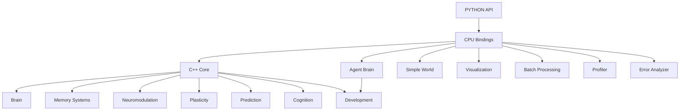

# NLM - Advanced Neural Learning Machine Python API

**An experimental artificial developmental brain with advanced simulation capabilities**

## Overview

NLM (熙然, meaning "serene flow") is an experimental computational brain project that implements a brain-inspired spiking neural network simulator with integrated memory, prediction, cognition, and neuromodulation systems.

The enhanced Python API provides **comprehensive advanced features** for researchers and developers working with neural learning machines, including:

## Key Advanced Features

### 🔬 Advanced Configuration
- **JSON Configuration**: Load/save complex configuration from JSON strings and files
- **Source Tracking**: Track configuration origins (File, CommandLine, Runtime, Default)
- **Validation**: Schema validation with detailed error reporting
- **Nested Configuration**: Support for hierarchical configuration structures

### 📊 Advanced Visualization & Analysis
- **Multi-modal Pipeline**: Network + activity + spikes + weights visualization
- **Graph Analysis**: Connectivity analysis, centrality measures, community detection
- **Statistical Analysis**: Compute network metrics and statistical properties
- **Dimensionality Reduction**: Create embeddings for neural activity patterns

### 🧠 Advanced Learning & Plasticity
- **Reward-Modulated STDP**: STDP with dopamine reward signals
- **Triplet STDP**: Higher-order spike timing dependencies
- **Hebbian Modes**: Various Hebbian learning configurations
- **Curiosity Integration**: Novelty-driven exploration with parameter tuning

### ⚡ Batch Processing & Automation
- **Batch Simulation**: Run multiple simulations with different parameters
- **Hyperparameter Search**: Automated parameter optimization
- **Cross-Validation**: Model validation across different conditions
- **State Management**: Save/load complex simulation states

### 🧬 Advanced Agent Capabilities
- **Custom Agents**: Create agents with specific architectures and neuron types
- **Multi-Agent Systems**: Create agent societies with interactions
- **Hierarchical Agents**: Layered agent structures with specialized functions
- **Agent Integration**: Deep integration with world and brain systems

### 🔍 Advanced Error Handling & Debugging
- **Verbose Logging**: Detailed logging control with multiple levels
- **Performance Profiling**: System-wide performance profiling and analysis
- **Error Analysis**: Systematic error detection and pattern analysis
- **Health Monitoring**: System health checks and diagnostics

## Architecture



## Installation

### Prerequisites
- Python 3.8+
- C++20 compiler (GCC 10+, Clang 12+)
- CMake 3.16+
- pybind11 2.11+
- scikit-build-core

### Installation from Source

```bash
# Install dependencies
pip install pybind11 scikit-build-core numpy pytest

# Clone the repository
# (already done - you're currently in the workspace)

# Build and install the Python module
cd /workspace/app
pip install .

# Or install in development mode for faster iteration
pip install -e .
```

### Verify Installation

```python
import pynlm

print("NLM Python bindings version:", pynlm.__version__)

# Create a basic brain
config = pynlm.createDefaultConfig()
brain = pynlm.createBrain(config)
brain.initialize()

print(f"Created brain with {brain.getTotalNeuronCount()} neurons")
print("Installation successful!")
```

## Basic Usage

### Quick Start

```python
import pynlm

# Create brain with default configuration
config = pynlm.createDefaultConfig()
brain = pynlm.createBrain(config)
brain.initialize()

# Run simulation
for step in range(100):
    brain.step(step)

print(f"Simulation complete: {brain.getTotalSpikeCount()} spikes")
```

### Complete Example

```python
import pynlm

def run_complete_simulation():
    # 1. Create configuration
    config = pynlm.createDefaultConfig()
    config.set("brain.neuron_count", 2000)
    
    # 2. Create and initialize brain
    brain = pynlm.createBrain(config)
    brain.initialize()
    
    # 3. Create agent interface
    agent = pynlm.createAgentBrain(brain)
    
    # 4. Create and configure world
    world = pynlm.createSimpleWorld()
    world.configure(width=20, height=20, visionWidth=8, visionHeight=8)
    world.reset()
    agent.initialize(world)
    
    # 5. Enable advanced features
    agent.enableRewardModulation(True)
    agent.enableCuriosity(True)
    agent.enableDevelopment(True)
    
    # 6. Run simulation
    for step in range(500):
        world.update(0.1)
        agent.processSensoryInput(world.getSensoryPercept())
        brain.step(step)
        action = agent.decodeMotorCommand()
        world.applyMotorCommand(action, world.getSimulationTime())
    
    return brain, agent, world

# Run the simulation
brain, agent, world = run_complete_simulation()

print(f"Completed simulation with {brain.getTotalSpikeCount()} spikes")
print(f"Final firing rate: {brain.getAverageFiringRate():.2f} Hz")
```

## Advanced Features Examples

### 1. JSON Configuration

```python
import pynlm
import json

# Create complex JSON configuration
advanced_config = {
    "brain": {
        "neuron_count": 5000,
        "synapse_density": 0.12,
        "structural_plasticity": {"enabled": True, "rate": 0.0001}
    },
    "plasticity": {
        "stdp": {"enabled": True, "learning_rate": 0.002},
        "hebbian": {"enabled": True, "learning_rate": 0.01}
    },
    "neuromodulation": {
        "curiosity": {"enabled": True, "novelty_weight": 0.7, "prediction_error_weight": 0.3},
        "dopamine": {"scale": 1.2}
    }
}

# Create and load configuration
config = pynlm.createDefaultConfig()
config.loadFromJSON(json.dumps(advanced_config))

# Use configuration
brain = pynlm.createBrain(config)
brain.initialize()
```

### 2. Visualization Pipeline

```python
import pynlm

# Create brain and world
config = pynlm.createDefaultConfig()
brain = pynlm.createBrain(config)
brain.initialize()

world = pynlm.createSimpleWorld()
world.configure(width=30, height=30)
world.reset()

agent = pynlm.createAgentBrain(brain)
agent.initialize(world)

# Enable advanced learning
agent.enableCuriosity(True)

# Create visualization pipeline
brain.createVisualizationPipeline()
brain.getVisualizationInterface().setUpdateRate(10.0)

# Run simulation with visualization
for step in range(200):
    world.update(0.1)
    agent.processSensoryInput(world.getSensoryPercept())
    brain.step(step)
    
    # Update visualization
    brain.getVisualizationInterface().update()
    
    if step % 50 == 0:
        print(f"Step {step}: {brain.getFiringNeuronCount()} neurons firing")

# Export visualization
brain.getVisualizationInterface().exportVisualization("simulation.gif")
```

### 3. Advanced Learning (Reward-Modulated STDP)

```python
import pynlm

# Create brain with advanced plasticity
config = pynlm.createDefaultConfig()
config.set("plasticity.advanced_stdp.reward_modulated", True)

brain = pynlm.createBrain(config)
brain.initialize()

# Enable advanced STDP
brain.enableRewardModulatedSTDP(True)
brain.enableTripletSTDP(True)

stdp = brain.getAdvancedSTDP()
stdp.setRewardScale(2.0)

print("Enabled reward-modulated and triplet STDP")

# Run simulation with rewards
for step in range(300):
    brain.step(step)
    
    # Apply reward modulation
    reward = 0.1 if step % 100 == 0 else 0.0
    brain.applyRewardModulation(reward)
    
    if step % 50 == 0:
        print(f"Step {step}: Reward={reward}, Firing={brain.getAverageFiringRate():.2f}")
```

### 4. Curiosity-Driven Exploration

```python
import pynlm

# Create agent with curiosity
config = pynlm.createDefaultConfig()
brain = pynlm.createBrain(config)
brain.initialize()

agent = pynlm.createAgentBrain(brain)
world = pynlm.createSimpleWorld()
world.configure(width=40, height=40)
world.reset()
agent.initialize(world)

# Enable curiosity with fine-tuned parameters
agent.enableCuriosity(True)
agent.setCuriosityParameters(novelty_weight=0.8, prediction_error_weight=0.2)

print(f"Curiosity parameters: novelty_weight=0.8, prediction_error_weight=0.2")

# Run exploration
exploration_data = []
for step in range(400):
    world.update(0.1)
    
    # Process sensory input
    percept = world.getSensoryPercept()
    agent.processSensoryInput(percept)
    
    # Brain processing
    brain.step(step)
    
    # Agent decision
    action = agent.decodeMotorCommand()
    world.applyMotorCommand(action, world.getSimulationTime())
    
    # Record exploration metrics
    exploration_data.append({
        'step': step,
        'curiosity': agent.getCuriosityLevel(),
        'novelty': agent.getNoveltyLevel(),
        'firing_rate': brain.getAverageFiringRate()
    })

# Analyze exploration
avg_curiosity = sum(d['curiosity'] for d in exploration_data) / len(exploration_data)
max_novelty = max(d['novelty'] for d in exploration_data)

print(f"Exploration analysis:")
print(f"  Average curiosity: {avg_curiosity:.3f}")
print(f"  Maximum novelty: {max_novelty:.3f}")
print(f"  Total exploration steps: {len(exploration_data)}")
```

### 5. Batch Processing

```python
import pynlm
import time

# Create batch processor
batch = pynlm.createBatchProcessor()

# Add multiple configurations
configs = [
    ("small_brain", 1000, 0.05),
    ("medium_brain", 2500, 0.1),
    ("large_brain", 5000, 0.15),
    ("sparse_brain", 3000, 0.02),
]

for name, neuron_count, density in configs:
    config = pynlm.createDefaultConfig()
    config.set("brain.neuron_count", neuron_count)
    config.set("brain.synapse_density", density)
    batch.addConfiguration(config, name)

print(f"Created batch with {len(batch.getConfigurations())} configurations")

# Create world template
world_template = pynlm.createSimpleWorld()
world_template.configure(width=20, height=20)

# Run batch simulation
print("Running batch simulation...")
start_time = time.time()

experiments = batch.runSimulationBatch(
    world_template,
    max_steps_per_simulation=100,
    progress_callback=lambda brain, step: print(f"  Step {step}")
)

end_time = time.time()

print(f"Batch simulation completed in {end_time - start_time:.2f} seconds")
print(f"Generated {len(experiments)} experimental results")

# Save results
batch.saveResults("batch_results.json")
print("Results saved to batch_results.json")

# Get statistics
stats = batch.getStatistics()
print(stats)
```

### 6. Hyperparameter Search

```python
import pynlm

# Create batch processor for hyperparameter search
batch = pynlm.createBatchProcessor()

# Define hyperparameter search space
hyperparameter_names = ["brain.synapse_density", "plasticity.stdp.learning_rate"]
hyperparameter_values = [
    [0.05, 0.001],
    [0.1, 0.005],
    [0.15, 0.01],
    [0.2, 0.02],
    [0.25, 0.001],
]

# Create world template
world_template = pynlm.createSimpleWorld()
world_template.configure(width=15, height=15)

print(f"Searching over {len(hyperparameter_values)} hyperparameter combinations")

# Run hyperparameter search
best_config = batch.runHyperparameterSearch(
    hyperparameter_names,
    hyperparameter_values,
    world_template,
    max_steps=200,
    progress_callback=lambda progress: print(f"  Progress: {progress*100:.0f}%")
)

if best_config:
    print(f"\nBest configuration found:")
    for key in best_config.getKeys():
        value = best_config.get(key)
        print(f"  {key}: {value}")
    
    # Save best configuration
    best_config.saveToFile("best_config.json")
    print("Best configuration saved to best_config.json")
else:
    print("No valid configuration found")
```

### 7. Multi-Agent System

```python
import pynlm

# Create multi-agent system
agent_template = pynlm.createDefaultConfig()
agent_template.set("brain.neuron_count", 1500)

print("Creating multi-agent system...")

# Create society of agents
agents = pynlm.createMultiAgentSystem(
    agent_count=5,
    template_config=agent_template
)

print(f"Created society with {len(agents)} agents")

# Create shared world
world = pynlm.createSimpleWorld()
world.configure(width=60, height=60)
world.reset()

# Initialize all agents
for i, agent in enumerate(agents):
    agent.initialize(world)

# Run multi-agent simulation
print("Running multi-agent simulation...")
for step in range(150):
    world.update(0.1)
    
    # Each agent operates independently
    for agent in agents:
        percept = world.getSensoryPercept()
        agent.processSensoryInput(percept)
        action = agent.decodeMotorCommand()
        world.applyMotorCommand(action, world.getSimulationTime())
    
    if step % 50 == 0:
        print(f"Step {step}: All agents have acted")

print("Multi-agent simulation completed")
```

### 8. Performance Profiling

```python
import pynlm

# Create brain for profiling
config = pynlm.createDefaultConfig()
brain = pynlm.createBrain(config)
brain.initialize()

# Create performance profiler
system_profiler = brain.getSystemProfiler()

# Run simulation with profiling
for step in range(100):
    brain.step(step)
    
    # Profile specific operations
    profiler = brain.createProfiler(f"step_{step}")
    
    # Simulate work
    result = step * step

# Get profiling results
report = system_profiler.getReport()
print("Performance Profiling Report:")
print(report)

print(f"\nTotal profiling time: {system_profiler.getTotalTime():.3f} seconds")
print(f"Operations profiled: {len(system_profiler.getOperationNames())}")
```

### 9. Error Analysis

```python
import pynlm

# Create error analyzer
error_analyzer = pynlm.createErrorAnalyzer()

# Simulate errors
error_analyzer.recordError(
    error_type="MEMORY_ALLOCATION",
    error_message="Failed to allocate memory",
    context="Simulation step 50",
    stack_trace="traceback_here..."
)

error_analyzer.recordError(
    error_type="CONVERGENCE",
    error_message="Learning failed to converge",
    context="Optimization routine",
    stack_trace="traceback_here..."
)

# Analyze error patterns
patterns = error_analyzer.analyzePatterns()
print("Error Pattern Analysis:")
for pattern in patterns:
    print(f"  - {pattern}")

# Get recent errors
recent_errors = error_analyzer.getRecentErrors(5)
print(f"\nRecent Errors ({len(recent_errors)}):")
for error in recent_errors:
    print(f"  - {error}")

# Get comprehensive report
report = error_analyzer.getReport()
print(f"\nError Analysis Report:\n{report}")

# Export error analysis
error_analyzer.exportErrors("error_analysis.txt")
print("Error analysis exported to error_analysis.txt")
```

## API Reference

### Core Classes

#### Brain
Main neural simulation class with advanced learning capabilities.

**Key Methods:**
- `initialize()`: Initialize brain with configuration
- `step(step, time)`: Perform simulation step
- `loadFromJSON(jsonString, validate)`: Load from JSON configuration
- `saveToJSON(jsonString)`: Save to JSON string
- `validateConfig(errorMessage)`: Validate configuration
- `enableRewardModulatedSTDP(enable)`: Enable reward-modulated STDP
- `enableTripletSTDP(enable)`: Enable triplet-based STDP
- `configureHebbianMode(mode)`: Configure Hebbian learning mode
- `setCuriosityParameters(noveltyWeight, predictionErrorWeight)`: Set curiosity parameters
- `createVisualizationPipeline()`: Create visualization pipeline
- `analyzeConnectivity()`: Analyze network connectivity
- `computeGraphMetrics()`: Compute graph metrics
- `createEmbedding(dimensions, embedding)`: Create dimensionality reduction embedding
- `createCustomAgent(neuronTypes, connections, customConfig)`: Create custom agent
- `enableMultiAgentSystem(agentCount, templateConfig)`: Create agent society
- `createHierarchicalAgent(layerNeuronCounts, layerTypes, hierarchicalConfig)`: Create hierarchical agent
- `setVerboseLogging(enable)`: Enable verbose logging
- `createProfiler(name)`: Create performance profiler
- `createErrorAnalyzer()`: Create error analyzer

#### Config
Enhanced configuration management with source tracking and validation.

**Key Methods:**
- `loadFromJSON(jsonString, validate)`: Load from JSON string
- `saveToJSON(jsonString)`: Save to JSON string
- `validateConfig(errorMessage)`: Validate configuration
- `setWithSource(key, value, source)`: Set value with source tracking

#### AgentBrain
Advanced agent brain interface with enhanced learning capabilities.

**Key Methods:**
- `setCuriosityParameters(noveltyWeight, predictionErrorWeight)`: Set curiosity parameters
- `createCustomAgent(neuronTypes, connections, customConfig)`: Create custom agent
- `enableMultiAgentSystem(agentCount, templateConfig)`: Create agent society
- `createHierarchicalAgent(layerNeuronCounts, layerTypes, hierarchicalConfig)`: Create hierarchical agent

### Advanced Classes

#### AdvancedSTDP
Advanced spike-timing-dependent plasticity with triplet and reward modulation.

#### VisualizationInterface
Multi-modal visualization pipeline for brain and neural activity.

#### Profiler
Performance profiler for timing operations and analysis.

#### ErrorAnalyzer
Systematic error analysis and pattern detection.

#### BatchProcessor
Batch processing utilities for multiple simulations and automation.

#### NetworkAnalysis
Static utilities for network connectivity and graph analysis.

#### Embedding
Utilities for dimensionality reduction and neural pattern analysis.

### Factory Functions

- `createBatchProcessor()`: Create batch processor
- `createVisualizationPipeline()`: Create visualization pipeline
- `createProfiler(name)`: Create performance profiler
- `createErrorAnalyzer()`: Create error analyzer

### Enumerations

- `ConfigSource`: Configuration source types (Default, File, CommandLine, Runtime)
- `NeuronType`: Neuron types (Excitatory, Inhibitory, Modulatory, Sensory, Motor, Internal)
- `SynapseType`: Synapse types (Excitatory, Inhibitory, Modulatory, Electrical, GapJunction)
- `DevelopmentalStage`: Developmental stages (Initial, CriticalPeriod, Maturation, Adult, Aging)
- `FiringState`: Neuron firing states (Resting, Active, Refractory, Inhibited)
- `ActionType`: Action types (MoveForward, MoveBackward, MoveLeft, MoveRight, etc.)
- `MotorCommand`: Motor commands (MoveForward, MoveBackward, TurnLeft, TurnRight, etc.)
- `WorldObjectType`: World object types (Empty, Resource, Hazard, Wall, Marker)

## Advanced Features Documentation

For comprehensive documentation on all advanced features, including:

1. **Advanced Configuration**: Complete JSON support, source tracking, validation
2. **Visualization & Analysis**: Multi-modal pipelines, network analysis, graph metrics
3. **Advanced Learning**: Reward-modulated STDP, triplet STDP, Hebbian modes, curiosity
4. **Batch Processing**: Simulation batches, hyperparameter search, cross-validation
5. **Advanced Agents**: Custom agents, multi-agent systems, hierarchical agents
6. **Error Handling**: Verbose logging, performance profiling, error analysis

Please refer to **ADVANCED_API_GUIDE.md** for complete documentation with examples.

## Building

```bash
# Standard build
mkdir build
cd build
cmake .. -DCMAKE_BUILD_TYPE=Release
make -j4

# Build Python bindings
pip install -e .

# Or build with Python integration
pip install .
```

## Testing

Run the comprehensive test suite:

```bash
# Run Python tests
pytest tests/

# Run C++ unit tests (if built)
./build/nlm_test

# Run Phase 6 integration test
./build/nlm_phase6_demo
```

## Troubleshooting

### Common Issues

1. **Python import error**
   ```bash
   pip install --force-reinstall .
   ```

2. **Compilation errors**
   Ensure all dependencies are installed:
   ```bash
   sudo apt-get install build-essential cmake
   pip install pybind11 scikit-build-core numpy
   ```

3. **Memory issues**
   For large simulations, increase system memory or reduce brain size.

4. **Performance issues**
   For better performance:
   - Use Release build type
   - Enable SIMD optimizations
   - Use fewer neurons for testing

## Future Enhancements

The enhanced Python API will continue to evolve with:

- **Advanced Memory Systems**: Working memory, episodic memory, associative memory
- **Prediction Integration**: Enhanced prediction systems with confidence tracking
- **Social Learning**: Multi-agent interaction and knowledge transfer
- **Continual Learning**: Adaptation to new information without forgetting
- **Advanced Visualization**: Real-time 3D visualization with interactivity
- **Distributed Computing**: Parallel processing across multiple machines

## License

MIT License

Copyright (c) 2026 NLM Research Project

Permission is hereby granted, free of charge, to any person obtaining a copy of this software and associated documentation files (the "Software"), to deal in the Software without restriction, including without limitation the rights to use, copy, modify, merge, publish, distribute, sublicense, and/or sell copies of the Software, and to permit persons to whom the Software is furnished to do so, subject to the following conditions:

The above copyright notice and this permission notice shall be included in all copies or substantial portions of the Software.

THE SOFTWARE IS PROVIDED "AS IS", WITHOUT WARRANTY OF ANY KIND, EXPRESS OR IMPLIED, INCLUDING BUT NOT LIMITED TO THE WARRANTIES OF MERCHANTABILITY, FITNESS FOR A PARTICULAR PURPOSE AND NONINFRINGEMENT. IN NO EVENT SHALL THE AUTHORS OR COPYRIGHT HOLDERS BE LIABLE FOR ANY CLAIM, DAMAGES OR OTHER LIABILITY, WHETHER IN AN ACTION OF CONTRACT, TORT OR OTHERWISE, ARISING FROM, OUT OF OR IN CONNECTION WITH THE SOFTWARE OR THE USE OR OTHER DEALINGS IN THE SOFTWARE.