# NLM Architecture Documentation

## Overview

This document describes the NLM (熙然) architecture, a modular computational brain with over 15 subsystems that learns from experience through neural dynamics and plasticity.

## Component Dependencies

### Core Layer (Foundation)
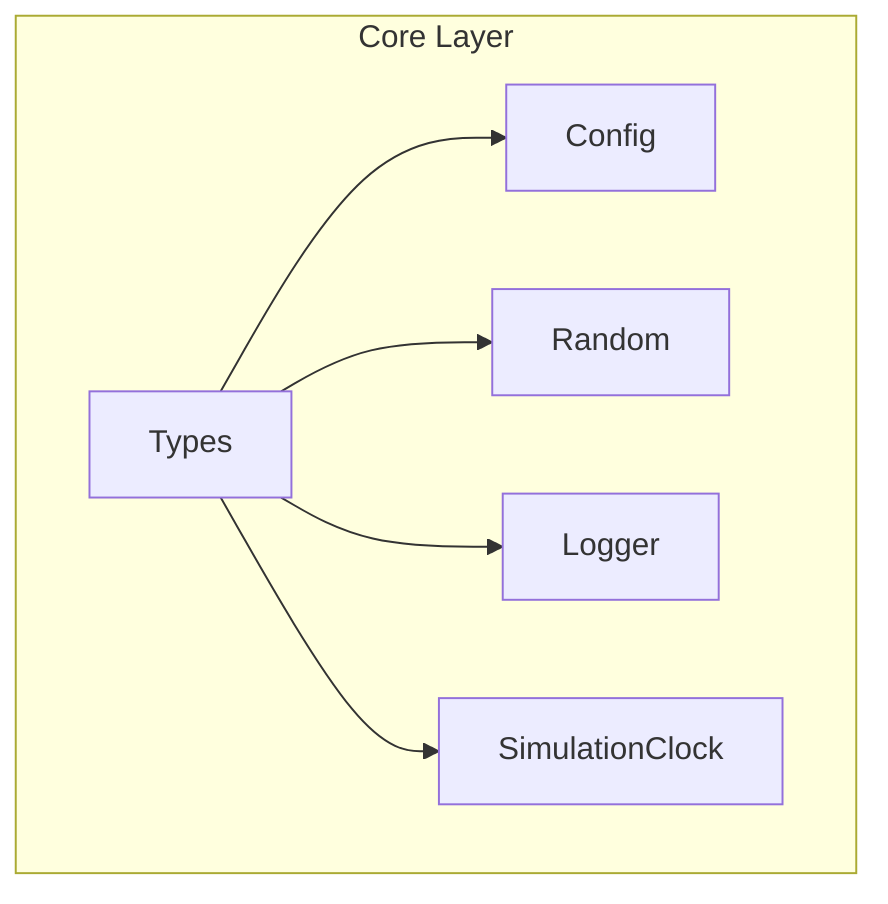

### Neural Layer (Biological Core)
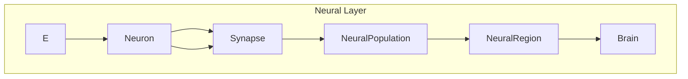

### Dynamics Layer (Computation)
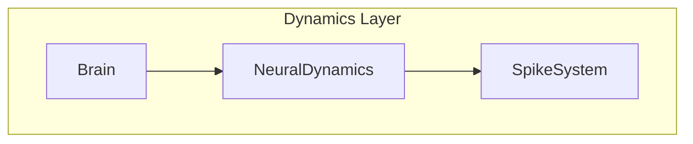

### Plasticity Layer (Learning)
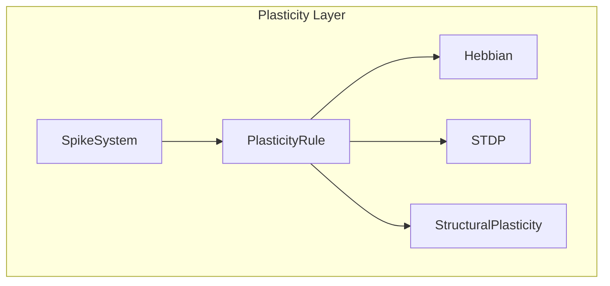

### Development Layer (Growth)
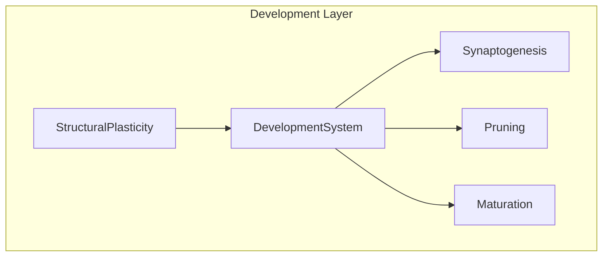

### Neuromodulation Layer (Motivation)
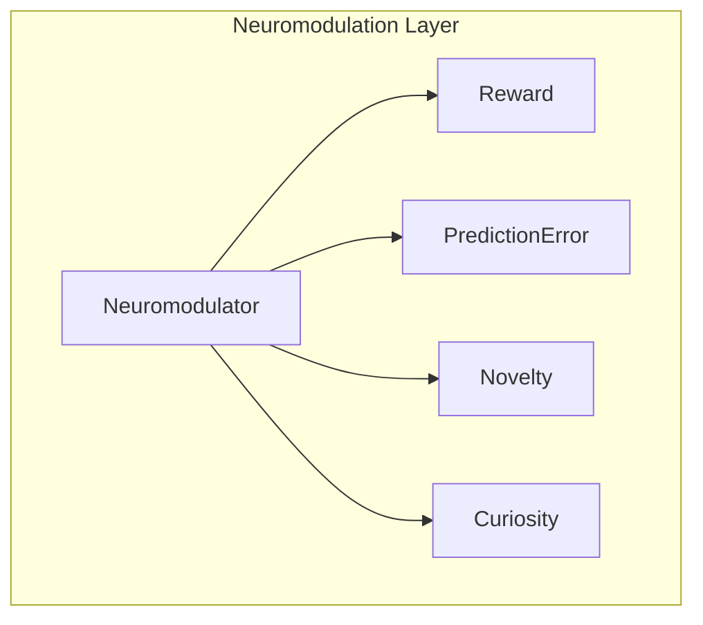

### Memory Layer (Storage)
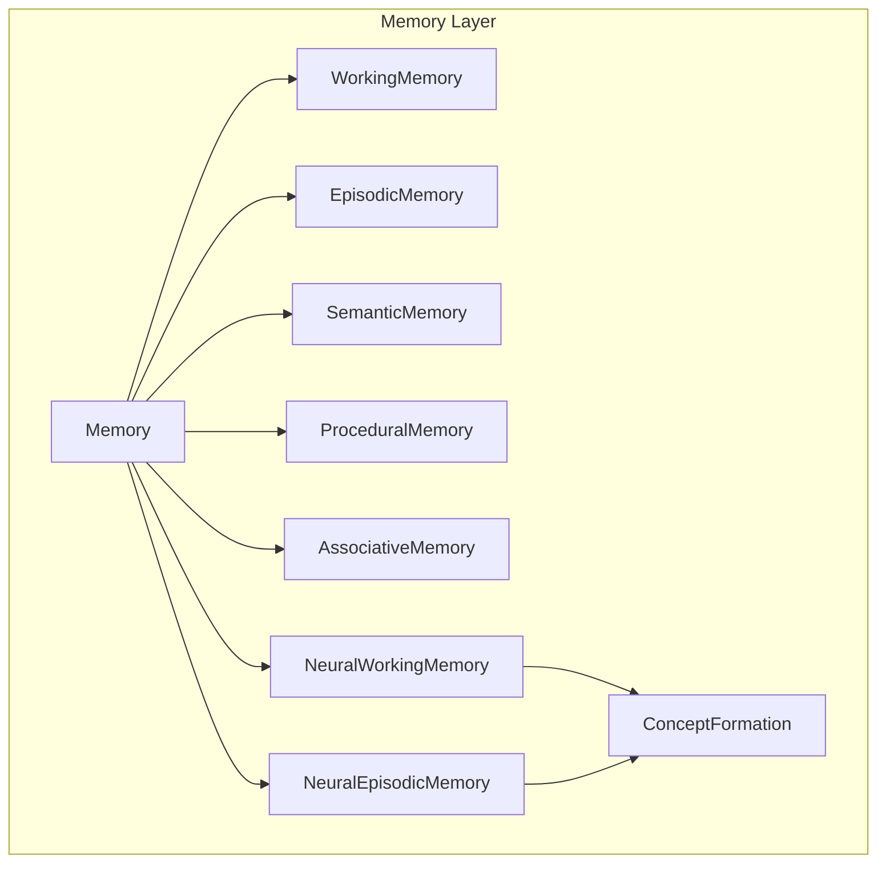

### Prediction Layer (Forecasting)
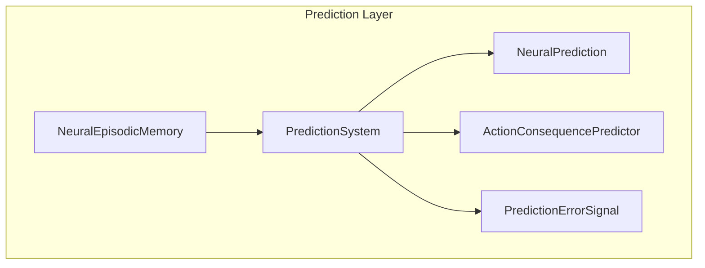

### Cognition Layer (Thinking)
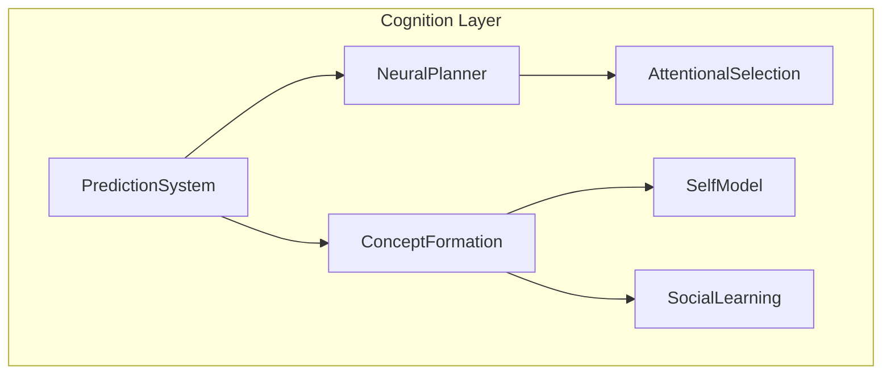

### Sensory Layer (Input)
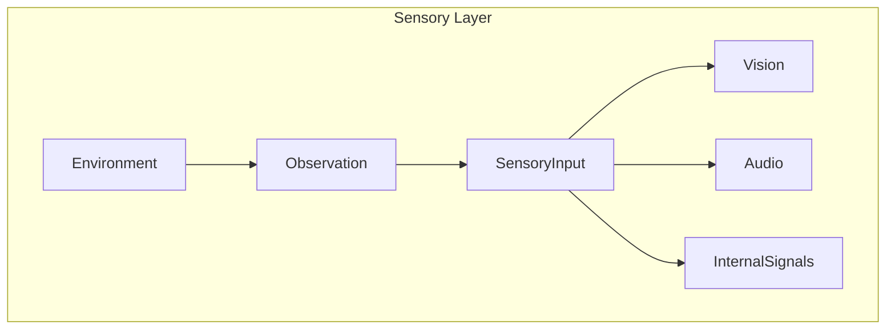

### Motor Layer (Output)
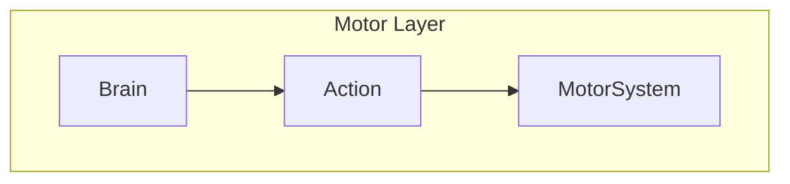

### Environment Interface
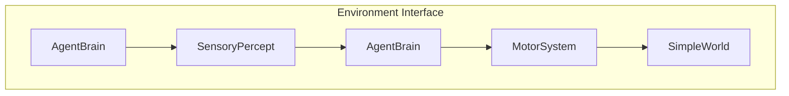

### Higher-Level Systems
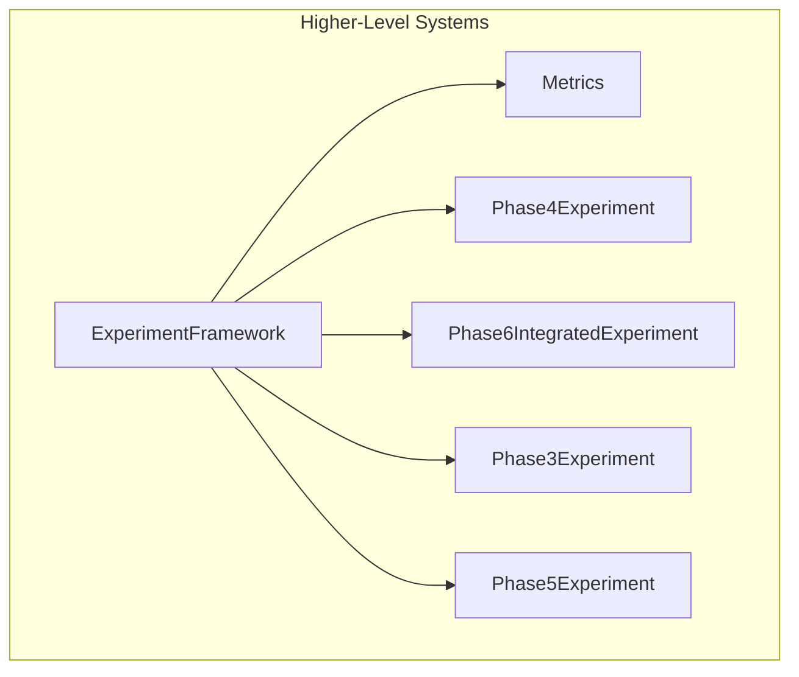

## Memory System Deep Dive

### Working Memory
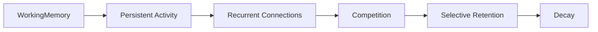

### Episodic Memory
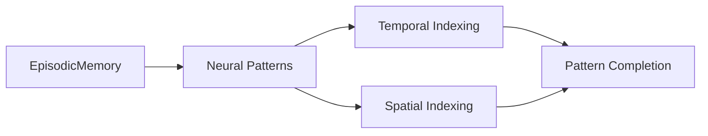

### Prediction System
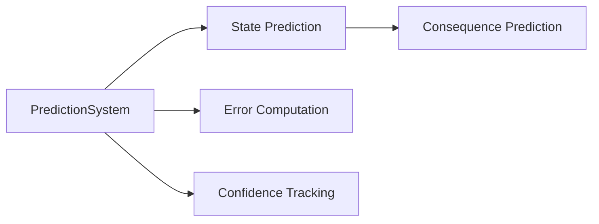

## Data Flow Architecture

### Phase 2: Neural Computation
```mermaid
graph LR
    A[Sensory Input] --> B[Brain.receiveSensoryInput()]
    B --> C[Neural Computation]
    C --> D[Spike Processing]
    D --> E[Plasticity]
    E --> F[Structural Plasticity]
```

### Phase 3: World Interaction
```mermaid
graph LR
    G[World] --> H[Sensory Percept]
    H --> I[AgentBrain.processSensoryInput()]
    I --> J[Brain.receiveSensoryInput()]
    J --> K[Neural Computation]
    K --> L[Motor Decoding]
    L --> M[AgentBrain.decodeMotorCommand()]
    M --> N[World.applyMotorCommand()]
    N --> O[Action Result]
    O --> P[Reward Prediction Error]
    P --> Q[Neuromodulation]
    Q --> R[Eligibility Trace]
    R --> S[Plasticity]
    S --> T[Development System]
```

### Phase 4: Cognitive Processing
```mermaid
graph LR
    G[World] --> H[Sensory Percept]
    H --> I[AttentionalSelection]
    I --> J[Neural Processing]
    J --> K[Prediction]
    K --> L[WorkingMemory]
    K --> M[EpisodicMemory]
    K --> N[ConceptFormation]
    L --> O[Planning]
    N --> O
    M --> O
    O --> P[Action Selection]
    P --> Q[Motor Action]
    Q --> R[World.applyMotorCommand()]
    R --> S[Action Result]
    S --> T[Neuromodulation]
    T --> U[SocialLearning]
```

## Configuration System

### Configuration File Format (JSON)

NLM now supports both simple `key=value` format and full JSON format. JSON provides better structure and easier integration with other tools.

#### Example JSON Configuration
```json
{
  "brain": {
    "neuron_count": 1000,
    "region_count": 2,
    "connection_probability": 0.1
  },
  "plasticity": {
    "stdp_ltp_weight": 0.02,
    "stdp_ltd_weight": 0.015,
    "stdp_time_constant": 20.0
  },
  "neuromodulation": {
    "dopamine_baseline": 0.1,
    "curiosity_threshold": 0.05
  },
  "environment": {
    "name": "GridWorld",
    "width": 10,
    "height": 10
  },
  "logging": {
    "level": "INFO",
    "to_file": false,
    "filename": "nlm.log"
  }
}
```

### Configuration Categories

#### Brain Configuration
| Parameter | Type | Default | Description |
|-----------|------|---------|-------------|
| `neuron_count` | integer | 1000 | Total number of neurons |
| `region_count` | integer | 1 | Number of brain regions |
| `connection_probability` | float | 0.1 | Probability of random connections |

#### Plasticity Configuration
| Parameter | Type | Default | Description |
|-----------|------|---------|-------------|
| `plasticity_learning_rate` | float | 0.01 | Base learning rate |
| `stdp_ltp_weight` | float | 0.02 | STDP LTP weight |
| `stdp_ltd_weight` | float | 0.015 | STDP LTD weight |
| `stdp_time_constant` | float | 20.0 | STDP time constant |

#### Neuromodulation Configuration
| Parameter | Type | Default | Description |
|-----------|------|---------|-------------|
| `dopamine_baseline` | float | 0.0 | Baseline dopamine level |
| `curiosity_threshold` | float | 0.05 | Threshold for curiosity-driven exploration |
| `novelty_decay` | float | 0.99 | Decay rate for novelty signals |

#### Environment Configuration
| Parameter | Type | Default | Description |
|-----------|------|---------|-------------|
| `environment_name` | string | "GridWorld" | Name of the environment |
| `environment_width` | integer | 10 | Width of the environment |
| `environment_height` | integer | 10 | Height of the environment |

#### Logging Configuration
| Parameter | Type | Default | Description |
|-----------|------|---------|-------------|
| `log_level` | string | "INFO" | Minimum log level |
| `log_to_file` | boolean | false | Whether to log to file |
| `log_filename` | string | "nlm.log" | Log file name |

## API Documentation Summary

### Core Classes

#### `nlm::Config`
- **Purpose**: Configuration management system
- **Features**: JSON/YAML support, command-line parsing, validation
- **Methods**: `loadFromFile()`, `loadFromArgs()`, `getOr()`, `set()`, `saveToFile()`

#### `nlm::Logger`
- **Purpose**: Structured logging system
- **Features**: Multiple log levels, file output, thread-safe
- **Methods**: `log()`, `debug()`, `info()`, `warning()`, `error()`, `critical()`

#### `nlm::SimulationClock`
- **Purpose**: Time management for simulations
- **Features**: Fixed timestep, simulation time tracking
- **Methods**: `getTime()`, `getStep()`, `advance()`

### Neural Classes

#### `nlm::Neuron`
- **Purpose**: LIF neuron implementation
- **Key Features**: Integrate-and-fire dynamics, refractory period
- **Methods**: `stepLIF()`, `injectCurrent()`, `getMembranePotential()`

#### `nlm::Synapse`
- **Purpose**: Synaptic connection with plasticity
- **Key Features**: Weight modulation, delay transmission
- **Methods**: `getWeight()`, `updateWeight()`, `transmit()`

#### `nlm::Brain`
- **Purpose**: Central neural coordinator
- **Key Features**: Spike management, plasticity coordination
- **Methods**: `step()`, `reset()`, `injectCurrentToNeurons()`, `logStatus()`

### Memory Classes

#### `nlm::WorkingMemory`
- **Purpose**: Persistent activity for temporary storage
- **Key Features**: Competition-based retention, decay

#### `nlm::EpisodicMemory`
- **Purpose**: Experience encoding in neural patterns
- **Key Features**: Temporal indexing, pattern completion

#### `nlm::PredictionSystem`
- **Purpose**: Temporal sequence learning and prediction
- **Key Features**: Prediction error computation, confidence tracking

### Neuromodulation Classes

#### `nlm::Neuromodulator`
- **Purpose**: Abstract base for neuromodulators
- **Key Features**: Reward, curiosity, novelty detection

#### `nlm::Dopamine`
- **Purpose**: Reward prediction error signal
- **Key Features**: Reward-modulated plasticity

#### `nlm::Curiosity`
- **Purpose**: Exploration motivation
- **Key Features**: Combines novelty and prediction error

### Environment Interface

#### `nlm::AgentBrain`
- **Purpose**: Bridge connecting brain to world
- **Key Features**: Sensory transduction, motor decoding

#### `nlm::SimpleWorld`
- **Purpose**: Simple 2D world simulation
- **Key Features**: Action application, state management

### Experiment Framework

#### `nlm::Experiment`
- **Purpose**: Single experiment recording
- **Key Features**: Data collection, metric tracking

#### `nlm::ExperimentRunner`
- **Purpose**: Experiment execution
- **Key Features**: Automated experiment management

## Extension Points

### Adding New Components

1. **Create new header files** in appropriate subdirectory
2. **Implement in corresponding .cpp files**
3. **Add to CMakeLists.txt** if part of core build
4. **Add to appropriate integration hook** in `Brain::step()`

### Modifying Existing Components

1. **Follow existing patterns** for consistency
2. **Update documentation** in ARCHITECTURE.md
3. **Add to CI testing** if behavior changes
4. **Update example configuration** files

## Building and Testing

### Build Commands

```bash
# Basic build
mkdir build
cd build
cmake .. -DCMAKE_BUILD_TYPE=Release
make -j4

# Build with tests
mkdir build_test
cd build_test
cmake .. -DBUILD_TESTS=ON
make -j4

# Build with Python bindings
mkdir build_pybind
cd build_pybind
cmake .. -DBUILD_PYTHON=ON
make -j4
```

### Testing

```bash
# Run unit tests
./nlm_test

# Run performance benchmarks
./benchmark

# Run integration experiments
./nlm_phase6_demo

# Run Python example
python3 -c "import pynlm; print(pynlm.__version__)"
```

### Configuration Testing

```bash
# Test JSON configuration
./nlm --config example.json

# Test simple configuration
./nlm --config configs/default.cfg
```

## Project Structure Summary

```
NLM/
├── CMakeLists.txt                    # Build configuration
├── README.md                         # User documentation
├── easy_usage.md                     # Quick start guide
├── HOW_TO_USE.md                      # Detailed usage instructions
├── docs/                             # Technical documentation
│   ├── ARCHITECTURE.md                # System architecture
│   ├── SCIEENCE.md                    # Scientific background
│   ├── ROADMAP.md                     # Development roadmap
│   ├── EXPERIMENTS.md                  # Experiment documentation
│   ├── LIMITATIONS.md                  # Known limitations
│   ├── PHASE6_FINAL_AUDIT.md           # Phase 6 audit results
│   ├── PHASE6_ARCHITECTURE.md          # Phase 6 specific architecture
│   ├── PHASE6_FINAL_RESULTS.md         # Phase 6 results
│   └── ... (other documentation files)
├── src/                              # Source code
│   ├── core/                         # Core utilities
│   │   ├── Config/                    # Configuration system
│   │   ├── Logger/                    # Logging system
│   │   ├── Random/                    # Random number generation
│   │   └── SimulationClock/            # Time management
│   ├── brain/                        # Neural components
│   ├── dynamics/                     # Neural dynamics
│   ├── plasticity/                   # Plasticity rules
│   ├── development/                  # Developmental system
│   ├── neuromodulation/               # Neuromodulators
│   ├── memory/                       # Memory systems
│   ├── prediction/                   # Prediction systems
│   ├── cognition/                    # Cognitive mechanisms
│   ├── sensory/                      # Sensory processing
│   ├── motor/                        # Motor system
│   ├── environment/                  # Environment interface
│   ├── agent/                        # Agent brain interface
│   ├── world/                        # World simulation
│   ├── experiments/                  # Experiment framework
│   └── visualization/                # Visualization
├── python/                           # Python bindings
├── tests/                           # Test suite
├── configs/                         # Configuration files
├── pyproject.toml                   # Python package configuration
└── ...                              # Other project files
```

## Dependencies

### Required Dependencies

| Component | Dependency | Version | Notes |
|-----------|------------|---------|-------|
| Core | C++20 Standard | Required | Modern C++ features |
| Build | CMake 3.16+ | Required | Cross-platform builds |
| Python | Python 3.8+ | Required | Python bindings |

### Optional Dependencies

- **JSON Library**: For enhanced configuration parsing
- **Visualization Libraries**: For advanced graphical output
- **Performance Tools**: For profiling and optimization

## Future Improvements

### Short-term (Phase 2)

1. **Complete JSON configuration parser**
2. **Implement web interface for visualization**
3. **Add comprehensive error handling**
4. **Enhance documentation with dependency diagrams**

### Medium-term (Phase 3)

1. **Add cloud/containerization support**
2. **Implement machine learning integration**
3. **Add advanced visualization capabilities**
4. **Enhance performance profiling tools**

### Long-term (Phase 4)

1. **Add sophisticated planning algorithms**
2. **Implement complex social learning**
3. **Add advanced concept formation**
4. **Integrate with external knowledge bases**

## Contact and Support

For questions, issues, or feature requests:

- **Documentation**: Read `README.md`, `easy_usage.md`, `HOW_TO_USE.md`
- **Architecture**: See `docs/ARCHITECTURE.md` and `docs/PHASE6_ARCHITECTURE.md`
- **Science**: See `docs/SCIENCE.md`
- **Issues**: Report on GitHub repository
- **Support**: Check project documentation for troubleshooting

---

This documentation provides a comprehensive overview of the NLM architecture, from core neural computation to high-level cognitive systems. The project continues to evolve with each phase, building increasingly sophisticated capabilities while maintaining biological inspiration and scientific rigor.