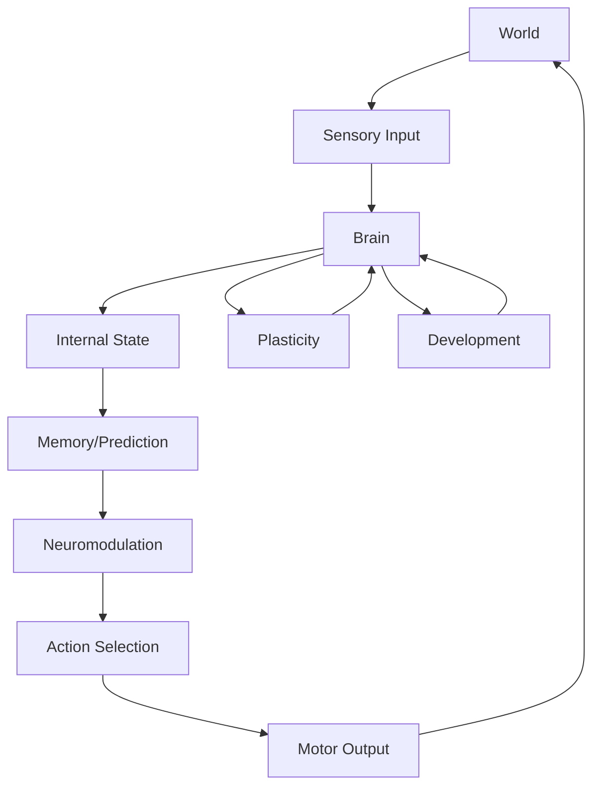

# Enhanced NLM Documentation
# Comprehensive Guide for Advanced Users and Developers

## Overview

This documentation provides advanced usage patterns, implementation details, and developer guidance for the enhanced NLM (Neural Learning Machine) system. It covers configuration options, performance optimization, debugging techniques, and advanced usage scenarios.

## Table of Contents

1. [Architecture Overview](#architecture-overview)
2. [Configuration Deep Dive](#configuration-deep-dive)
3. [Performance Optimization](#performance-optimization)
4. [Advanced Development Techniques](#advanced-development-techniques)
5. [Debugging and Testing](#debugging-and-testing)
6. [Custom Extensions](#custom-extensions)
7. [Migration Guide](#migration-guide)
8. [Troubleshooting](#troubleshooting)
9. [API Reference](#api-reference)

---

## Architecture Overview

### System Components

NLM is composed of several interconnected subsystems:

#### Core Neural Engine
- **Brain**: Central neural processing unit with spiking neurons
- **Spike System**: Event-driven spike propagation and synaptic transmission
- **Plasticity Rules**: STDP, Hebbian, and structural plasticity mechanisms

#### Cognitive Architecture
- **Working Memory**: Transient information storage and processing
- **Episodic Memory**: Experience recording and replay
- **Associative Memory**: Pattern association and recall
- **Prediction System**: Forward models and prediction error computation
- **Cognition Systems**: Planning, concept formation, attention

#### Neuromodulation
- **Dopamine**: Reward prediction error and reinforcement
- **Curiosity**: Exploration motivation and intrinsic drive
- **Novelty**: Unpredictability detection
- **Prediction Error**: Model updating and learning signals

#### Development System
- **Maturation**: Neural development stages
- **Synaptogenesis**: New connection formation
- **Pruning**: Connection elimination and refinement
- **Structural Plasticity**: Anatomical changes

#### Interface Layer
- **Sensory Systems**: Vision, audio, proprioception, internal signals
- **Motor Systems**: Action selection and execution
- **Agent Interface**: Integration between brain and environment
- **World Simulation**: Environmental dynamics and interactions

### System Integration



---

## Configuration Deep Dive

### Configuration Categories

#### Brain Configuration
```json
{
    "brain": {
        "neuron_count": 1000,
        "region_count": 2,
        "connection_probability": 0.1,
        "initial_weight_mean": 0.5,
        "initial_weight_std": 0.1,
        "v_thresh": -50.0,
        "v_rest": -70.0,
        "v_reset": -75.0,
        "tau_mem": 20.0,
        "tau_ref": 2.0,
        "neuron_types": {
            "excitatory": 0.8,
            "inhibitory": 0.15,
            "sensory": 0.03,
            "motor": 0.02,
            "internal": 0.02
        }
    }
}
```

#### Plasticity Configuration
```json
{
    "plasticity": {
        "stdp": {
            "enable": true,
            "learning_rate": 0.001,
            "tau_plus": 20.0,
            "tau_minus": 20.0,
            "weight_range": {"min": 0.0, "max": 2.0},
            "pre_post_window": {"pre": 0, "post": 20},
            "post_pre_window": {"pre": -20, "post": 0}
        },
        "hebbian": {
            "enable": true,
            "learning_rate": 0.01,
            "weight_increase": 0.1,
            "weight_decrease": 0.1
        },
        "structural": {
            "enable": true,
            "synaptogenesis_rate": 0.0001,
            "pruning_rate": 0.00001,
            "max_connections_per_neuron": 100,
            "min_connections_per_neuron": 1
        },
        "reward_modulated": {
            "enable": true,
            "dopamine_factor": 0.5,
            "eligibility_window": 100
        }
    }
}
```

#### Neuromodulation Configuration
```json
{
    "neuromod": {
        "dopamine": {
            "baseline": 0.1,
            "surge_strength": 1.0,
            "decay_time": 500.0,
            "prediction_error_gain": 0.5,
            "reward_prediction_error": true
        },
        "curiosity": {
            "enable": true,
            "baseline": 0.1,
            "exploration_bonus": 0.5,
            "novelty_sensitivity": 0.3,
            "intrinsic_motivation": 0.2,
            "cool_down_period": 100
        },
        "novelty": {
            "enable": true,
            "sensitivity": 0.5,
            "detection_threshold": 0.1,
            "adaptation_rate": 0.01,
            "max_novelty": 1.0
        },
        "prediction_error": {
            "enable": true,
            "gain": 1.0,
            "learning_rate": 0.1,
            "error_threshold": 0.01
        }
    }
}
```

#### Development Configuration
```json
{
    "development": {
        "stages": {
            "initial": {
                "start_age": 0,
                "end_age": 10,
                "plasticity_multiplier": 1.0,
                "growth_rate": 0.01
            },
            "critical_period": {
                "start_age": 10,
                "end_age": 50,
                "enhanced_plasticity": true,
                "sensitive_period": true
            },
            "maturation": {
                "start_age": 50,
                "end_age": 150,
                "plasticity_multiplier": 0.8,
                "efficiency_gain": 0.05
            },
            "adult": {
                "start_age": 150,
                "end_age": 500,
                "plasticity_multiplier": 0.5,
                "maintenance_mode": true
            },
            "aging": {
                "start_age": 500,
                "end_age": 1000,
                "plasticity_multiplier": 0.3,
                "decay_rate": 0.01
            }
        },
        "synaptogenesis": {
            "rate": 0.0001,
            "target_connections": 50,
            "region_specific": true,
            "activity_dependent": true
        },
        "pruning": {
            "rate": 0.00001,
            "threshold_weak": 0.1,
            "threshold_strong": 0.9,
            "activity_dependent": true,
            "regional_balance": true
        }
    }
}
```

### Configuration Management

#### Programmatic Configuration
```python
import pynlm

# Create custom configuration
config = pynlm.create_config({
    "brain": {
        "neuron_count": 2000,
        "region_count": 3,
        "connection_probability": 0.15
    },
    "plasticity": {
        "stdp": {"enable": True, "learning_rate": 0.002},
        "structural": {"enable": True, "synaptogenesis_rate": 0.0002}
    },
    "development": {
        "enable": True,
        "stage": "critical_period"
    }
})

# Load from file
config.load_from_file("custom_config.json")

# Save configuration
config.save_to_file("optimized_config.json")

# Configuration templates
config_templates = {
    "research": {"neuron_count": 5000, "plasticity": {"stdp": {"enable": True}}},
    "production": {"neuron_count": 1000, "performance_mode": True},
    "development": {"neuron_count": 100, "debug_mode": True, "checkpointing": True},
    "simulation": {"neuron_count": 10000, "enable_all_systems": True}
}
```

#### Environment Variables
```bash
export NLM_CONFIG_PATH="../configs/advanced_config.json"
export NLM_LOG_LEVEL="DEBUG"
export NLM_SIMULATION_STEPS=10000
export NLM_RANDOM_SEED=12345
export NLM_PERFORMANCE_MODE="optimized"
export NLM_PYTHON_BINDINGS="enhanced"
```

---

## Performance Optimization

### Compilation Optimizations

#### CMake Build Options
```bash
# Release build with all optimizations
cmake -DCMAKE_BUILD_TYPE=Release \
     -DCMAKE_INTERPROCEDURAL_OPTIMIZATION=ON \
     -DCMAKE_POSITION_INDEPENDENT_CODE=ON \
     -DCMAKE_CXX_FLAGS="-O3 -march=native -flto" \
     -DPYTHON_BINDINGS_ENABLED=ON \
     -DNLM_ENABLE_EXAMPLES=ON \
     -DNLM_ENABLE_TESTS=ON

# Debug build with instrumentation
cmake -DCMAKE_BUILD_TYPE=Debug \
     -DCMAKE_CXX_FLAGS="-g -O0 -DDEBUG -DPROFILE -fno-omit-frame-pointer"

# Memory-efficient build
cmake -DCMAKE_BUILD_TYPE=Release \
     -DCMAKE_CXX_FLAGS="-Os -march=x86-64-v3 -mtune=generic"
```

#### Build Scripts
```bash
#!/bin/bash
# Optimized build script for NLM

set -e

SCRIPT_DIR="$(cd "$(dirname "${BASH_SOURCE[0]}")" && pwd)"
BUILD_DIR="${SCRIPT_DIR}/build"

# Configuration
BUILD_TYPE="Release"
PARALLEL_JOBS=$(nproc)
PYTHON_BINDINGS="ON"
EXAMPLES="ON"
TESTS="ON"
PERFORMANCE_OPTS="ON"

# Parse command line arguments
while [[ $# -gt 0 ]]; do
    case $1 in
        --debug)
            BUILD_TYPE="Debug"
            shift
            ;;
        --no-python)
            PYTHON_BINDINGS="OFF"
            shift
            ;;
        --no-examples)
            EXAMPLES="OFF"
            shift
            ;;
        --no-tests)
            TESTS="OFF"
            shift
            ;;
        --no-performance)
            PERFORMANCE_OPTS="OFF"
            shift
            ;;
        --jobs)
            PARALLEL_JOBS="$2"
            shift 2
            ;;
        --help)
            echo "Usage: $0 [options]"
            echo "Options:"
            echo "  --debug              Build with debug symbols"
            echo "  --no-python         Disable Python bindings"
            echo "  --no-examples       Disable example executables"
            echo "  --no-tests          Disable test suite"
            echo "  --no-performance    Disable performance optimizations"
            echo "  --jobs N            Number of parallel jobs (default: $(nproc))"
            echo "  --help              Show this help"
            exit 0
            ;;
        *)
            echo "Unknown option: $1"
            echo "Use --help for usage information"
            exit 1
            ;;
    esac
done

# Create build directory
mkdir -p "${BUILD_DIR}"
cd "${BUILD_DIR}"

# Configure CMake
cmake \
    -DCMAKE_BUILD_TYPE="${BUILD_TYPE}" \
    -DCMAKE_INTERPROCEDURAL_OPTIMIZATION="${PERFORMANCE_OPTS}" \
    -DPYTHON_BINDINGS_ENABLED="${PYTHON_BINDINGS}" \
    -DNLM_BUILD_EXAMPLES="${EXAMPLES}" \
    -DNLM_BUILD_TESTS="${TESTS}" \
    -DCMAKE_CXX_STANDARD=20 \
    -DCMAKE_CXX_STANDARD_REQUIRED=ON \
    -DCMAKE_CXX_EXTENSIONS=OFF \
    -DCMAKE_POSITION_INDEPENDENT_CODE=ON

# Build
cmake --build . --config "${BUILD_TYPE}" --parallel "${PARALLEL_JOBS}"

# Run tests if enabled
if [[ "${TESTS}" == "ON" ]]; then
    ctest --output-on-failure -C "${BUILD_TYPE}"
fi

# Create performance benchmark suite
if [[ -f "${SCRIPT_DIR}/benchmarks/run_benchmarks.sh" ]]; then
    echo "Running performance benchmarks..."
    bash "${SCRIPT_DIR}/benchmarks/run_benchmarks.sh" "${BUILD_DIR}"
fi

echo "Build completed successfully!"
echo "Executables:"
find . -name "nlm_*" -type f -executable | head -10
```

### Runtime Optimizations

#### Neuron Pooling
```cpp
// Efficient neuron memory management
class NeuronPool {
private:
    struct NeuronBlock {
        std::vector<Neuron> neurons;
        NeuronBlock* next;
    };
    
    NeuronBlock* freeList_;
    size_t blockSize_;
    std::mutex mutex_;
    
public:
    NeuronPool(size_t blockSize = 1024) : blockSize_(blockSize), freeList_(nullptr) {}
    
    ~NeuronPool() {
        NeuronBlock* block = freeList_;
        while (block) {
            NeuronBlock* next = block->next;
            delete block;
            block = next;
        }
    }
    
    Neuron* allocate() {
        std::lock_guard<std::mutex> lock(mutex_);
        if (!freeList_) {
            freeList_ = new NeuronBlock{std::vector<Neuron>(blockSize_), nullptr};
        }
        
        Neuron* neuron = &freeList_->neurons.back();
        freeList_->neurons.pop_back();
        
        if (freeList_->neurons.empty()) {
            NeuronBlock* old = freeList_;
            freeList_ = freeList_->next;
            delete old;
        }
        
        return neuron;
    }
    
    void deallocate(Neuron* neuron) {
        std::lock_guard<std::mutex> lock(mutex_);
        // Find the block containing this neuron
        NeuronBlock* block = freeList_;
        while (block && &block->neurons[0] != neuron) {
            block = block->next;
        }
        
        if (block && &block->neurons.back() == neuron) {
            block->neurons.push_back(*neuron);
            if (block->neurons.size() == blockSize_) {
                NeuronBlock* old = block;
                freeList_ = block->next;
                block->next = nullptr;
                delete old;
            }
        }
    }
};
```

#### Spike Event Optimization
```cpp
// Event-driven spike propagation with optimization
class OptimizedSpikeSystem : public SpikeSystem {
private:
    struct SpikeQueue {
        SpikeEvent events[1024]; // Fixed-size circular buffer
        size_t head, tail, size;
        
        SpikeQueue() : head(0), tail(0), size(0) {}
        
        bool push(const SpikeEvent& event) {
            if (size >= 1024) return false;
            events[tail] = event;
            tail = (tail + 1) % 1024;
            size++;
            return true;
        }
        
        bool pop(SpikeEvent& event) {
            if (size == 0) return false;
            event = events[head];
            head = (head + 1) % 1024;
            size--;
            return true;
        }
        
        bool empty() const { return size == 0; }
        size_t count() const { return size; }
    };
    
    SpikeQueue spikeQueue_;
    std::vector<std::vector<Neuron*>> neuronLookupTable_;
    
public:
    void step(SimulationStep step, Timestamp time) override {
        // Process spikes in batches
        SpikeEvent spike;
        while (spikeQueue_.pop(spike)) {
            processSpike(spike, step, time);
        }
        
        // Schedule new spikes
        scheduleSpikes(step, time);
    }
    
    void injectCurrent(NeuronId neuron, MembranePotential current) override {
        Neuron* n = findNeuron(neuron);
        if (n) {
            n->injectCurrent(current);
            if (n->shouldSpike()) {
                SpikeEvent event{neuron, getCurrentTime(), step};
                spikeQueue_.push(event);
            }
        }
    }
};
```

#### Configuration Caching
```cpp
// Configuration with caching and lazy evaluation
class OptimizedConfig : public Config {
private:
    mutable std::unordered_map<std::string, std::any> cache_;
    mutable std::mutex cacheMutex_;
    
    template<typename T>
    T getCached(const std::string& key, T defaultValue,
               std::function<T(const Config&)> compute) const {
        std::lock_guard<std::mutex> lock(cacheMutex_);
        
        auto it = cache_.find(key);
        if (it != cache_.end()) {
            return std::any_cast<T>(it->second);
        }
        
        T value = compute(*this);
        cache_[key] = value;
        return value;
    }
    
public:
    // Override get methods with caching
    int64_t getOr(const std::string& key, int64_t defaultValue) const override {
        return getCached<int64_t>(key, defaultValue,
            [this](const Config& c) { return c.getOr(key, defaultValue); });
    }
    
    float getOr(const std::string& key, float defaultValue) const override {
        return getCached<float>(key, defaultValue,
            [this](const Config& c) { return c.getOr(key, defaultValue); });
    }
    
    void clearCache() {
        std::lock_guard<std::mutex> lock(cacheMutex_);
        cache_.clear();
    }
};
```

### Advanced Usage Patterns

#### Brain Pooling
```python
# Reuse brain instances for performance
import pynlm
import time

class BrainPool:
    def __init__(self, size=5):
        self.pool = []
        self.size = size
        self.lock = threading.Lock()
    
    def get_brain(self, config=None):
        with self.lock:
            if self.pool:
                return self.pool.pop()
            return pynlm.create_brain(config or pynlm.create_default_config())
    
    def return_brain(self, brain):
        with self.lock:
            if len(self.pool) < self.size:
                brain.reset()
                self.pool.append(brain)
    
    def run_batch_simulation(self, simulations):
        results = []
        for i in range(0, len(simulations), self.size):
            batch = simulations[i:i + self.size]
            brains = [self.get_brain() for _ in range(len(batch))]
            
            try:
                for brain, steps in zip(brains, batch):
                    start_time = time.time()
                    for step in range(steps):
                        brain.step(step)
                    elapsed = time.time() - start_time
                    results.append({
                        'steps': steps,
                        'time': elapsed,
                        'rate': steps / elapsed if elapsed > 0 else 0
                    })
            finally:
                for brain in brains:
                    self.return_brain(brain)
        
        return results
```

#### Parallel Processing
```python
# Parallel brain simulation using multiprocessing
import pynlm
import multiprocessing as mp
from concurrent.futures import ProcessPoolExecutor
import time

class ParallelBrainSimulator:
    def __init__(self, num_workers=None):
        self.num_workers = num_workers or mp.cpu_count()
        self.executor = ProcessPoolExecutor(max_workers=self.num_workers)
    
    def simulate_brain(self, config_file=None, steps=1000):
        """Simulate a single brain instance"""
        config = pynlm.create_default_config()
        if config_file:
            config.load_from_file(config_file)
        
        brain = pynlm.create_brain(config)
        brain.initialize()
        
        start_time = time.time()
        for step in range(steps):
            brain.step(step)
        
        elapsed = time.time() - start_time
        return {
            'total_spikes': brain.get_total_spike_count(),
            'firing_rate': brain.get_average_firing_rate(),
            'steps_per_second': steps / elapsed,
            'time': elapsed
        }
    
    def run_parallel_simulation(self, num_simulations=10, steps_per_sim=1000):
        """Run multiple simulations in parallel"""
        futures = []
        
        for i in range(num_simulations):
            future = self.executor.submit(
                self.simulate_brain,
                None,  # config_file
                steps_per_sim
            )
            futures.append(future)
        
        results = []
        for future in futures:
            results.append(future.result())
        
        return results
    
    def performance_benchmark(self, scenarios):
        """Benchmark different configuration scenarios"""
        results = {}
        
        for name, config_kwargs in scenarios.items():
            config = pynlm.create_default_config()
            # Apply config_kwargs (simplified for example)
            
            brain = pynlm.create_brain(config)
            brain.initialize()
            
            # Benchmark different step counts
            step_counts = [100, 1000, 5000]
            scenario_results = {}
            
            for steps in step_counts:
                start_time = time.time()
                for step in range(steps):
                    brain.step(step)
                
                elapsed = time.time() - start_time
                scenario_results[f'steps_{steps}'] = {
                    'time': elapsed,
                    'rate': steps / elapsed,
                    'spikes_per_second': brain.get_total_spike_count() / elapsed
                }
            
            results[name] = scenario_results
        
        return results
```

---

## Advanced Development Techniques

### Custom Brain Extensions

#### Brain Factory Pattern
```cpp
// Brain factory for creating specialized brain instances
class BrainFactory {
public:
    enum class BrainType {
        STANDARD,
        RESEARCH,
        PRODUCTION,
        DEVELOPMENT,
        CUSTOM
    };
    
    static std::shared_ptr<Brain> createBrain(BrainType type, 
                                            const std::shared_ptr<Config>& config = nullptr) {
        auto baseConfig = config ? config : std::make_shared<Config>();
        
        switch (type) {
            case BrainType::STANDARD:
                return createStandardBrain(baseConfig);
            case BrainType::RESEARCH:
                return createResearchBrain(baseConfig);
            case BrainType::PRODUCTION:
                return createProductionBrain(baseConfig);
            case BrainType::DEVELOPMENT:
                return createDevelopmentBrain(baseConfig);
            case BrainType::CUSTOM:
                return createCustomBrain(baseConfig);
            default:
                return createStandardBrain(baseConfig);
        }
    }
    
private:
    static std::shared_ptr<Brain> createStandardBrain(const std::shared_ptr<Config>& config) {
        // Standard configuration optimized for research
        config->setIfEmpty("brain.neuron_count", 1000);
        config->setIfEmpty("brain.region_count", 2);
        config->setIfEmpty("plasticity.stdp.enable", true);
        config->setIfEmpty("plasticity.hebbian.enable", true);
        config->setIfEmpty("neuromod.dopamine.enable", true);
        config->setIfEmpty("neuromod.curiosity.enable", true);
        config->setIfEmpty("development.enable", true);
        
        return std::make_shared<Brain>(config);
    }
    
    // Other brain types...
};
```

#### Plugin Architecture
```cpp
// Brain plugin system for extensibility
class BrainPlugin {
public:
    virtual ~BrainPlugin() = default;
    
    virtual std::string getName() const = 0;
    virtual std::string getVersion() const = 0;
    virtual bool initialize() = 0;
    virtual void shutdown() = 0;
    virtual void applyToBrain(std::shared_ptr<Brain> brain) = 0;
};

// Example plugin: Custom plasticity enhancer
class CustomPlasticityPlugin : public BrainPlugin {
public:
    std::string getName() const override { return "CustomPlasticity"; }
    std::string getVersion() const override { return "1.0.0"; }
    
    bool initialize() override {
        // Initialize plugin-specific resources
        return true;
    }
    
    void shutdown() override {
        // Clean up resources
    }
    
    void applyToBrain(std::shared_ptr<Brain> brain) override {
        // Enhance plasticity
        if (auto* region = brain->getRegion(RegionId(1))) {
            for (auto& syn : region->getSynapses()) {
                syn->enablePlasticity(true, true, true, true);
                syn->setWeight(syn->getWeight() * 1.1f); // Initial boost
            }
        }
    }
};
```

### Performance Monitoring

#### Real-time Metrics Collection
```cpp
// Performance monitoring and metrics collection
class PerformanceMonitor {
private:
    struct Metrics {
        double cpuUsage;
        double memoryUsage;
        double simulationTime;
        size_t spikeCount;
        size_t neuronCount;
        double averageFiringRate;
        Timestamp wallClockTime;
    };
    
    Metrics currentMetrics_;
    std::vector<Metrics> history_;
    std::chrono::steady_clock::time_point lastUpdate_;
    bool enabled_;
    
public:
    PerformanceMonitor() : enabled_(false) {}
    
    void enable() {
        enabled_ = true;
        lastUpdate_ = std::chrono::steady_clock::now();
        history_.clear();
    }
    
    void disable() {
        enabled_ = false;
    }
    
    void update(const std::shared_ptr<Brain>& brain) {
        if (!enabled_) return;
        
        auto now = std::chrono::steady_clock::now();
        auto elapsed = std::chrono::duration_cast<std::chrono::milliseconds>(now - lastUpdate_);
        
        currentMetrics_.cpuUsage = getCPUUsage();
        currentMetrics_.memoryUsage = getMemoryUsage();
        currentMetrics_.simulationTime = elapsed.count() / 1000.0;
        currentMetrics_.spikeCount = brain->getTotalSpikeCount();
        currentMetrics_.neuronCount = brain->getTotalNeuronCount();
        currentMetrics_.averageFiringRate = brain->getAverageFiringRate();
        currentMetrics_.wallClockTime = getWallClockTime();
        
        history_.push_back(currentMetrics_);
        lastUpdate_ = now;
    }
    
    double getAverageFiringRate(size_t window = 100) const {
        if (history_.size() < window) return currentMetrics_.averageFiringRate;
        
        double totalRate = 0.0;
        size_t count = std::min(window, history_.size());
        
        for (size_t i = history_.size() - count; i < history_.size(); ++i) {
            totalRate += history_[i].averageFiringRate;
        }
        
        return totalRate / count;
    }
    
    std::vector<Metrics> getPerformanceProfile() const {
        return history_;
    }
    
    void generateReport(const std::string& filename) const {
        std::ofstream file(filename);
        if (!file) return;
        
        file << "Performance Report" << std::endl;
        file << "=================" << std::endl << std::endl;
        
        file << "Metrics collected: " << history_.size() << std::endl;
        file << "Average firing rate: " << getAverageFiringRate() << std::endl;
        file << "Average simulation time: " << getAverageSimulationTime() << " ms" << std::endl;
        
        file << std::endl << "Detailed Metrics:" << std::endl;
        file << "Step,CPU%,Memory%,SimTime(ms),Spikes,Neurons,FiringRate" << std::endl;
        
        for (size_t i = 0; i < history_.size(); ++i) {
            file << i << ",";
            file << history_[i].cpuUsage << ",";
            file << history_[i].memoryUsage << ",";
            file << history_[i].simulationTime << ",";
            file << history_[i].spikeCount << ",";
            file << history_[i].neuronCount << ",";
            file << history_[i].averageFiringRate << std::endl;
        }
        
        file << std::endl << "Performance Statistics:" << std::endl;
        file << "Max CPU usage: " << getMaxCPUUsage() << "%" << std::endl;
        file << "Min CPU usage: " << getMinCPUUsage() << "%" << std::endl;
        file << "Average CPU usage: " << getAverageCPUUsage() << "%" << std::endl;
        file << "Max memory usage: " << getMaxMemoryUsage() << "%" << std::endl;
        file << "Min memory usage: " << getMinMemoryUsage() << "%" << std::endl;
        file << "Average memory usage: " << getAverageMemoryUsage() << "%" << std::endl;
    }
    
private:
    // Helper methods for system metrics
    double getCPUUsage() {
        // Implementation varies by platform
        return 0.0;
    }
    
    double getMemoryUsage() {
        // Implementation varies by platform
        return 0.0;
    }
    
    double getWallClockTime() {
        return std::chrono::duration<double>(std::chrono::steady_clock::now().time_since_epoch()).count();
    }
    
    double getAverageSimulationTime() const {
        if (history_.empty()) return 0.0;
        double total = 0.0;
        for (const auto& metrics : history_) {
            total += metrics.simulationTime;
        }
        return total / history_.size();
    }
    
    double getMaxCPUUsage() const {
        double max = 0.0;
        for (const auto& metrics : history_) {
            max = std::max(max, metrics.cpuUsage);
        }
        return max;
    }
    
    double getMinCPUUsage() const {
        double min = 100.0;
        for (const auto& metrics : history_) {
            min = std::min(min, metrics.cpuUsage);
        }
        return min;
    }
    
    double getAverageCPUUsage() const {
        double total = 0.0;
        for (const auto& metrics : history_) {
            total += metrics.cpuUsage;
        }
        return history_.empty() ? 0.0 : total / history_.size();
    }
    
    double getMaxMemoryUsage() const {
        double max = 0.0;
        for (const auto& metrics : history_) {
            max = std::max(max, metrics.memoryUsage);
        }
        return max;
    }
    
    double getMinMemoryUsage() const {
        double min = 100.0;
        for (const auto& metrics : history_) {
            min = std::min(min, metrics.memoryUsage);
        }
        return min;
    }
    
    double getAverageMemoryUsage() const {
        double total = 0.0;
        for (const auto& metrics : history_) {
            total += metrics.memoryUsage;
        }
        return history_.empty() ? 0.0 : total / history_.size();
    }
};
```

### Advanced Configuration Management

#### Configuration Validation
```cpp
// Configuration validation system
class ConfigurationValidator {
public:
    struct ValidationResult {
        bool valid;
        std::vector<std::string> errors;
        std::vector<std::string> warnings;
    };
    
    static ValidationResult validate(const Config& config) {
        ValidationResult result;
        
        // Validate brain configuration
        validateBrainConfig(config, result);
        
        // Validate plasticity configuration
        validatePlasticityConfig(config, result);
        
        // Validate neuromodulation configuration
        validateNeuromodConfig(config, result);
        
        // Validate development configuration
        validateDevelopmentConfig(config, result);
        
        // Validate performance constraints
        validatePerformanceConstraints(config, result);
        
        return result;
    }
    
private:
    static void validateBrainConfig(const Config& config, ValidationResult& result) {
        // Check neuron count constraints
        int64_t neuronCount = config.getOr<int64_t>("brain.neuron_count", 1000);
        if (neuronCount < 10) {
            result.warnings.push_back("Small neuron count may not represent realistic brain dynamics");
        }
        if (neuronCount > 100000) {
            result.errors.push_back("Neuron count too high for current implementation");
        }
        
        // Check region count constraints
        int64_t regionCount = config.getOr<int64_t>("brain.region_count", 1);
        if (regionCount > neuronCount / 100) {
            result.warnings.push_back("Too many regions for neuron count");
        }
        
        // Check connection probability
        float connProb = config.getOr<float>("brain.connection_probability", 0.1);
        if (connProb < 0.01) {
            result.warnings.push_back("Very low connection probability may lead to disconnected network");
        }
        if (connProb > 0.5) {
            result.warnings.push_back("Very high connection probability may lead to over-connected network");
        }
    }
    
    static void validatePlasticityConfig(const Config& config, ValidationResult& result) {
        // Check plasticity enable/disable combinations
        bool stdpEnabled = config.getOr<bool>("plasticity.stdp.enable", true);
        bool hebbianEnabled = config.getOr<bool>("plasticity.hebbian.enable", true);
        bool structuralEnabled = config.getOr<bool>("plasticity.structural.enable", true);
        
        if (!stdpEnabled && !hebbianEnabled && !structuralEnabled) {
            result.warnings.push_back("All plasticity mechanisms disabled - brain will not learn");
        }
        
        // Check learning rate ranges
        float stdpRate = config.getOr<float>("plasticity.stdp.learning_rate", 0.001);
        if (stdpRate < 0.0001 || stdpRate > 0.1) {
            result.warnings.push_back("STDP learning rate outside typical range");
        }
    }
    
    static void validateNeuromodConfig(const Config& config, ValidationResult& result) {
        bool dopamineEnabled = config.getOr<bool>("neuromod.dopamine.enable", true);
        bool curiosityEnabled = config.getOr<bool>("neuromod.curiosity.enable", true);
        bool noveltyEnabled = config.getOr<bool>("neuromod.novelty.enable", true);
        
        if (!dopamineEnabled && !curiosityEnabled && !noveltyEnabled) {
            result.warnings.push_back("All neuromodulation disabled - brain will not have motivation");
        }
    }
    
    static void validateDevelopmentConfig(const Config& config, ValidationResult& result) {
        bool devEnabled = config.getOr<bool>("development.enable", true);
        std::string stage = config.getOr<std::string>("development.stage", "adult");
        
        if (devEnabled) {
            // Validate stage compatibility
            if (stage == "critical_period" && config.getOr<bool>("development.aging.enable", false)) {
                result.warnings.push_back("Critical period and aging stages may conflict");
            }
        }
    }
    
    static void validatePerformanceConstraints(const Config& config, ValidationResult& result) {
        // Check for performance bottlenecks
        int64_t neuronCount = config.getOr<int64_t>("brain.neuron_count", 1000);
        
        if (neuronCount > 5000) {
            result.warnings.push_back("Large neuron count may impact performance - consider optimization");
        }
        
        // Check timestep constraints
        double timestep = config.getOr<double>("brain.timestep", 0.001);
        if (timestep < 1e-6) {
            result.warnings.push_back("Very small timestep may impact performance");
        }
        if (timestep > 0.1) {
            result.warnings.push_back("Large timestep may lead to inaccurate simulation");
        }
    }
};
```

---

## Debugging and Testing

### Systematic Debugging Approach

#### Debug Configuration
```cpp
// Debug configuration for development
struct DebugConfig {
    bool enableLogging;
    bool enableAssertions;
    bool enableValidation;
    bool enableProfiling;
    bool enableCheckpointing;
    std::string logFile;
    int logLevel;
    std::chrono::milliseconds timeout;
    
    DebugConfig() : enableLogging(true),
                    enableAssertions(true),
                    enableValidation(true),
                    enableProfiling(false),
                    enableCheckpointing(true),
                    logFile("nlm_debug.log"),
                    logLevel(2), // INFO level
                    timeout(5000) {} // 5 second timeout
};
```

#### Debug Logging
```cpp
// Enhanced logging system
class DebugLogger {
private:
    std::ofstream logFile_;
    std::mutex logMutex_;
    std::atomic<bool> enabled_;
    std::chrono::steady_clock::time_point startTime_;
    
    enum LogLevel {
        TRACE = 0,
        DEBUG = 1,
        INFO = 2,
        WARN = 3,
        ERROR = 4,
        FATAL = 5
    };
    
public:
    DebugLogger() : enabled_(true) {
        startTime_ = std::chrono::steady_clock::now();
        // Try to open log file
        logFile_.open("nlm_debug.log", std::ios::app);
    }
    
    ~DebugLogger() {
        if (logFile_.is_open()) {
            logFile_.close();
        }
    }
    
    void log(const std::string& message, LogLevel level = INFO) {
        if (!enabled_) return;
        
        std::lock_guard<std::mutex> lock(logMutex_);
        
        // Get timestamp
        auto now = std::chrono::steady_clock::now();
        auto elapsed = std::chrono::duration_cast<std::chrono::milliseconds>(now - startTime_);
        
        // Format log message
        std::stringstream ss;
        ss << "[" << elapsed.count() << "ms] ";
        ss << getLevelString(level) << ": ";
        ss << message << std::endl;
        
        // Output to file
        logFile_ << ss.str();
        
        // Also output to stderr for immediate visibility
        std::cerr << ss.str();
    }
    
    void setEnabled(bool enabled) {
        enabled_ = enabled;
    }
    
    void setLogLevel(LogLevel level) {
        // Implementation depends on actual log level storage
    }
    
    void startProfiling() {
        // Start CPU profiling
        // Implementation depends on platform
    }
    
    void stopProfiling() {
        // Stop CPU profiling
        // Implementation depends on platform
    }
    
    void saveProfile(const std::string& filename) {
        // Save profiling data
        // Implementation depends on profiler type
    }
    
private:
    std::string getLevelString(LogLevel level) {
        switch (level) {
            case TRACE: return "TRACE";
            case DEBUG: return "DEBUG";
            case INFO: return "INFO";
            case WARN: return "WARN";
            case ERROR: return "ERROR";
            case FATAL: return "FATAL";
            default: return "UNKNOWN";
        }
    }
};
```

#### Debug Utilities
```cpp
// Debug utilities for testing and debugging
namespace DebugUtils {
    // Memory debugging
    class MemoryDebugger {
    public:
        struct MemoryInfo {
            size_t totalAllocated;
            size_t peakAllocated;
            size_t currentAllocated;
            size_t allocationCount;
        };
        
        static MemoryInfo getMemoryInfo() {
            // Implementation platform-specific
            MemoryInfo info{};
            return info;
        }
        
        static void logMemoryUsage(const std::string& context = "") {
            auto info = getMemoryInfo();
            std::cout << "Memory Debug [" << context << "]:" << std::endl;
            std::cout << "  Total allocated: " << info.totalAllocated << " bytes" << std::endl;
            std::cout << "  Peak allocated: " << info.peakAllocated << " bytes" << std::endl;
            std::cout << "  Current allocated: " << info.currentAllocated << " bytes" << std::endl;
            std::cout << "  Allocation count: " << info.allocationCount << std::endl;
        }
    };
    
    // Performance debugging
    class PerformanceDebugger {
    public:
        struct TimingInfo {
            double totalTime;
            double minTime;
            double maxTime;
            double averageTime;
            size_t callCount;
        };
        
        static TimingInfo measureTime(const std::function<void()>& func) {
            // Implementation with high-resolution timing
            TimingInfo info{};
            return info;
        }
        
        static void profileFunction(const std::string& name, std::function<void()> func) {
            auto start = std::chrono::high_resolution_clock::now();
            func();
            auto end = std::chrono::high_resolution_clock::now();
            auto duration = std::chrono::duration_cast<std::chrono::nanoseconds>(end - start);
            
            std::cout << "Profile: " << name << " took " << duration.count() << " ns" << std::endl;
        }
    };
    
    // State debugging
    class StateDebugger {
    public:
        static void saveBrainState(const std::shared_ptr<Brain>& brain, const std::string& filename) {
            if (brain->save(filename)) {
                std::cout << "Brain state saved to " << filename << std::endl;
            } else {
                std::cerr << "Failed to save brain state to " << filename << std::endl;
            }
        }
        
        static bool loadBrainState(const std::shared_ptr<Brain>& brain, const std::string& filename) {
            if (brain->load(filename)) {
                std::cout << "Brain state loaded from " << filename << std::endl;
                return true;
            } else {
                std::cerr << "Failed to load brain state from " << filename << std::endl;
                return false;
            }
        }
        
        static void compareBrains(const std::shared_ptr<Brain>& brain1, const std::shared_ptr<Brain>& brain2) {
            std::cout << "Brain comparison:" << std::endl;
            std::cout << "  Neuron count: " << brain1->getTotalNeuronCount() << " vs " << brain2->getTotalNeuronCount() << std::endl;
            std::cout << "  Synapse count: " << brain1->getTotalSynapseCount() << " vs " << brain2->getTotalSynapseCount() << std::endl;
            std::cout << "  Spike count: " << brain1->getTotalSpikeCount() << " vs " << brain2->getTotalSpikeCount() << std::endl;
            std::cout << "  Firing rate: " << brain1->getAverageFiringRate() << " vs " << brain2->getAverageFiringRate() << std::endl;
        }
    };
}
```

### Testing Framework

#### Unit Testing
```cpp
// Enhanced unit testing framework
class TestFramework {
private:
    struct TestResult {
        std::string name;
        bool passed;
        double executionTime;
        std::string errorMessage;
        std::map<std::string, std::any> metadata;
    };
    
    std::vector<TestResult> results_;
    bool verboseMode_;
    bool failFast_;
    
public:
    TestFramework() : verboseMode_(false), failFast_(false) {}
    
    void setVerbose(bool verbose) {
        verboseMode_ = verbose;
    }
    
    void setFailFast(bool failFast) {
        failFast_ = failFast;
    }
    
    template<typename TestFunc>
    void addTest(const std::string& name, TestFunc test) {
        std::chrono::steady_clock::time_point start = std::chrono::steady_clock::now();
        
        TestResult result;
        result.name = name;
        result.passed = false;
        result.errorMessage = "";
        
        try {
            test();
            result.passed = true;
        } catch (const std::exception& e) {
            result.passed = false;
            result.errorMessage = e.what();
        }
        
        auto end = std::chrono::steady_clock::now();
        result.executionTime = std::chrono::duration<double>(end - start).count();
        
        results_.push_back(result);
        
        if (verboseMode_) {
            printTestResult(result);
        }
        
        if (!result.passed && failFast_) {
            throw std::runtime_error("Test failed and fail-fast is enabled");
        }
    }
    
    void runAllTests() {
        std::cout << "=== Running NLM Tests ===" << std::endl;
        
        // Add all tests
        // (In practice, this would be populated with all test functions)
        
        // Print summary
        printTestSummary();
        
        // Check for failures
        bool allPassed = true;
        for (const auto& result : results_) {
            if (!result.passed) {
                allPassed = false;
                break;
            }
        }
        
        if (!allPassed) {
            throw std::runtime_error("Some tests failed");
        }
    }
    
    void generateReport(const std::string& filename) {
        std::ofstream file(filename);
        if (!file) return;
        
        file << "NLM Test Report" << std::endl;
        file << "=================" << std::endl << std::endl;
        
        file << "Total tests: " << results_.size() << std::endl;
        file << "Passed: " << getPassedCount() << std::endl;
        file << "Failed: " << getFailedCount() << std::endl;
        file << "Success rate: " << getSuccessRate() * 100 << "%" << std::endl;
        file << std::endl;
        
        file << "Detailed Results:" << std::endl;
        file << "Test Name,Status,Execution Time (s),Error Message" << std::endl;
        
        for (const auto& result : results_) {
            file << result.name << ",";
            file << (result.passed ? "PASS" : "FAIL") << ",";
            file << result.executionTime << ",";
            file << result.errorMessage << std::endl;
        }
        
        file << std::endl << "Performance Statistics:" << std::endl;
        file << "Average test time: " << getAverageTestTime() << " s" << std::endl;
        file << "Fastest test: " << getFastestTestName() << " (" << getFastestTestTime() << " s)" << std::endl;
        file << "Slowest test: " << getSlowestTestName() << " (" << getSlowestTestTime() << " s)" << std::endl;
        
        file.close();
    }
    
private:
    void printTestResult(const TestResult& result) {
        std::cout << (result.passed ? "[PASS] " : "[FAIL] ") << result.name;
        if (!result.errorMessage.empty()) {
            std::cout << ": " << result.errorMessage;
        }
        std::cout << " (" << result.executionTime << " s)" << std::endl;
    }
    
    void printTestSummary() {
        int passedCount = getPassedCount();
        int failedCount = getFailedCount();
        
        std::cout << std::endl;
        std::cout << "=== Test Summary ===" << std::endl;
        std::cout << "Total tests: " << results_.size() << std::endl;
        std::cout << "Passed: " << passedCount << std::endl;
        std::cout << "Failed: " << failedCount << std::endl;
        std::cout << "Success rate: " << (passedCount / static_cast<double>(results_.size()) * 100) << "%" << std::endl;
        
        if (failedCount > 0) {
            std::cout << std::endl << "Failed tests:" << std::endl;
            for (const auto& result : results_) {
                if (!result.passed) {
                    std::cout << "  " << result.name;
                    if (!result.errorMessage.empty()) {
                        std::cout << ": " << result.errorMessage;
                    }
                    std::cout << std::endl;
                }
            }
        }
    }
    
    int getPassedCount() const {
        int count = 0;
        for (const auto& result : results_) {
            if (result.passed) count++;
        }
        return count;
    }
    
    int getFailedCount() const {
        int count = 0;
        for (const auto& result : results_) {
            if (!result.passed) count++;
        }
        return count;
    }
    
    double getSuccessRate() const {
        if (results_.empty()) return 1.0;
        return getPassedCount() / static_cast<double>(results_.size());
    }
    
    double getAverageTestTime() const {
        double total = 0.0;
        for (const auto& result : results_) {
            total += result.executionTime;
        }
        return results_.empty() ? 0.0 : total / results_.size();
    }
    
    std::string getFastestTestName() const {
        if (results_.empty()) return "";
        
        auto fastest = std::min_element(results_.begin(), results_.end(),
            [](const TestResult& a, const TestResult& b) {
                return a.executionTime < b.executionTime;
            });
        
        return fastest->name;
    }
    
    double getFastestTestTime() const {
        if (results_.empty()) return 0.0;
        
        auto fastest = std::min_element(results_.begin(), results_.end(),
            [](const TestResult& a, const TestResult& b) {
                return a.executionTime < b.executionTime;
            });
        
        return fastest->executionTime;
    }
    
    std::string getSlowestTestName() const {
        if (results_.empty()) return "";
        
        auto slowest = std::max_element(results_.begin(), results_.end(),
            [](const TestResult& a, const TestResult& b) {
                return a.executionTime < b.executionTime;
            });
        
        return slowest->name;
    }
    
    double getSlowestTestTime() const {
        if (results_.empty()) return 0.0;
        
        auto slowest = std::max_element(results_.begin(), results_.end(),
            [](const TestResult& a, const TestResult& b) {
                return a.executionTime < b.executionTime;
            });
        
        return slowest->executionTime;
    }
};
```

---

## Custom Extensions

### Brain Extensions

#### Custom Plasticity Rule
```cpp
// Custom plasticity rule implementation
class CustomPlasticityRule : public PlasticityRule {
private:
    struct ConnectionInfo {
        NeuronId preNeuron;
        NeuronId postNeuron;
        float weight;
        float eligibilityTrace;
        float rewardPredictionError;
        float dopamine;
    };
    
    std::vector<ConnectionInfo> connections_;
    float learningRate_;
    float eligibilityDecay_;
    float dopamineGain_;
    
public:
    CustomPlasticityRule(float learningRate = 0.01, 
                       float eligibilityDecay = 0.9,
                       float dopamineGain = 1.0)
        : learningRate_(learningRate),
          eligibilityDecay_(eligibilityDecay),
          dopamineGain_(dopamineGain) {}
    
    void applyPlasticity(Neuron* preNeuron, Neuron* postNeuron, 
                        float currentTime) override {
        // Find connection
        auto it = std::find_if(connections_.begin(), connections_.end(),
            [preNeuron, postNeuron](const ConnectionInfo& conn) {
                return conn.preNeuron == preNeuron->getId() && 
                       conn.postNeuron == postNeuron->getId();
            });
        
        if (it == connections_.end()) {
            // Create new connection
            ConnectionInfo conn;
            conn.preNeuron = preNeuron->getId();
            conn.postNeuron = postNeuron->getId();
            conn.weight = 0.5f;
            conn.eligibilityTrace = 0.0f;
            conn.rewardPredictionError = 0.0f;
            conn.dopamine = 0.0f;
            connections_.push_back(conn);
            it = connections_.end() - 1;
        }
        
        // Apply custom plasticity rule
        float eligibilityChange = computeEligibilityChange(preNeuron, postNeuron, currentTime);
        it->eligibilityTrace = it->eligibilityTrace * eligibilityDecay_ + eligibilityChange;
        
        // Update weight based on dopamine and eligibility trace
        float weightChange = it->dopamine * it->eligibilityTrace * dopamineGain_ * learningRate_;
        it->weight += weightChange;
        
        // Clamp weight to valid range
        it->weight = std::max(0.0f, std::min(it->weight, 2.0f));
        
        // Update connection in brain
        updateConnectionInBrain(preNeuron, postNeuron, it->weight);
    }
    
    void setDopamine(float dopamine, float rewardPredictionError, 
                    const std::vector<Neuron*>& activeNeurons) override {
        // Update dopamine for all connections involving active neurons
        for (auto& conn : connections_) {
            bool involved = false;
            for (Neuron* neuron : activeNeurons) {
                if (conn.preNeuron == neuron->getId() || 
                    conn.postNeuron == neuron->getId()) {
                    involved = true;
                    break;
                }
            }
            
            if (involved) {
                conn.dopamine = dopamine;
                conn.rewardPredictionError = rewardPredictionError;
            }
        }
    }
    
    float getLearningRate() const override {
        return learningRate_;
    }
    
    void setLearningRate(float rate) override {
        learningRate_ = rate;
    }
    
protected:
    virtual float computeEligibilityChange(Neuron* preNeuron, Neuron* postNeuron, float currentTime) {
        // Implement custom eligibility trace computation
        // This could be based on spike timing, correlation, or other factors
        return 1.0f; // Simplified for example
    }
    
    virtual void updateConnectionInBrain(Neuron* preNeuron, Neuron* postNeuron, float weight) {
        // Find and update the connection in the brain's synapse system
        // This would typically involve accessing the brain's internal structures
        // For this example, we'll leave it as a placeholder
    }
};
```

#### Custom Neuron Model
```cpp
// Custom neuron model with additional dynamics
class CustomNeuronModel : public Neuron {
private:
    struct IonicState {
        float sodium;
        float potassium;
        float calcium;
        float chloride;
        float leak;
    };
    
    IonicState ionicState_;
    float membraneCapacitance_;
    float temperature_;
    float metabolicRate_;
    
public:
    CustomNeuronModel() : Neuron() {
        // Initialize ionic state
        ionicState_.sodium = -55.0f;
        ionicState_.potassium = -80.0f;
        ionicState_.calcium = 0.1f;
        ionicState_.chloride = -65.0f;
        ionicState_.leak = -70.0f;
        
        membraneCapacitance_ = 1.0f;
        temperature_ = 37.0f; // Celsius
        metabolicRate_ = 1.0f;
    }
    
    void step(float dt) override {
        // Custom ion channel dynamics
        updateIonicChannels(dt);
        
        // Modified membrane potential update
        updateMembranePotential(dt);
        
        // Custom spike generation
        checkSpikeCondition();
        
        // Metabolic considerations
        updateMetabolicState(dt);
        
        // Temperature effects
        applyTemperatureEffects(dt);
        
        Neuron::step(dt); // Call parent class for basic functionality
    }
    
    void injectCurrent(float current) override {
        // Custom current injection with filtering
        filteredCurrent_ += (current - filteredCurrent_) * 0.1f;
        Neuron::injectCurrent(filteredCurrent_);
    }
    
    void setTemperature(float temperature) {
        temperature_ = temperature;
    }
    
    void setMetabolicRate(float rate) {
        metabolicRate_ = rate;
    }
    
protected:
    virtual void updateIonicChannels(float dt) {
        // Custom Hodgkin-Huxley type dynamics
        // This would be a detailed implementation of ion channel kinetics
        // For simplicity, we'll use modified equations
        
        float dt_factor = dt * 0.001f; // Time constant factor
        
        // Sodium dynamics
        float sodium_rate = computeSodiumRate(ionicState_.sodium, getMembranePotential());
        ionicState_.sodium += sodium_rate * dt_factor;
        
        // Potassium dynamics
        float potassium_rate = computePotassiumRate(ionicState_.potassium, getMembranePotential());
        ionicState_.potassium += potassium_rate * dt_factor;
        
        // Calcium dynamics
        float calcium_rate = computeCalciumRate(ionicState_.calcium, getMembranePotential());
        ionicState_.calcium += calcium_rate * dt_factor;
        
        // Leak currents
        float leak_rate = computeLeakRate(ionicState_.leak, getMembranePotential());
        ionicState_.leak += leak_rate * dt_factor;
    }
    
    virtual void updateMembranePotential(float dt) {
        // Modified membrane potential equation
        float dV_dt = (getInjectedCurrent() - 
                      getMembranePotential() * getConductance() +
                      computeIonicCurrents()) / 
                     membraneCapacitance_;
        
        setMembranePotential(getMembranePotential() + dV_dt * dt);
    }
    
    virtual void updateMetabolicState(float dt) {
        // Metabolic effects on neuron properties
        // This could affect ion channel conductances, etc.
        float metabolic_effect = metabolicRate_ * dt;
        // Apply metabolic effects (simplified)
        setThreshold(getThreshold() + metabolic_effect * 0.01f);
    }
    
    virtual void applyTemperatureEffects(float dt) {
        // Temperature effects on ion channel kinetics
        float temperature_factor = (temperature_ - 37.0f) / 10.0f; // Normalized around 37°C
        
        // Adjust rates based on temperature
        // Q10 temperature coefficient typical for biological processes
        float q10_factor = std::pow(2.0f, temperature_factor);
        
        // Scale membrane time constant
        float time_constant = getMembraneTimeConstant() * q10_factor;
        setMembraneTimeConstant(time_constant);
        
        // Scale threshold
        float threshold_shift = (temperature_ - 37.0f) * 0.1f;
        setThreshold(getThreshold() + threshold_shift);
    }
    
    virtual float computeSodiumRate(float sodium_conc, float membrane_potential) {
        // Simplified sodium rate equation
        return (sodium_conc - (-55.0f)) * 0.1f;
    }
    
    virtual float computePotassiumRate(float potassium_conc, float membrane_potential) {
        // Simplified potassium rate equation
        return (potassium_conc - (-80.0f)) * 0.1f;
    }
    
    virtual float computeCalciumRate(float calcium_conc, float membrane_potential) {
        // Simplified calcium rate equation
        return (calcium_conc - 0.1f) * 0.05f;
    }
    
    virtual float computeLeakRate(float leak_conc, float membrane_potential) {
        // Simplified leak rate equation
        return (leak_conc - (-70.0f)) * 0.05f;
    }
    
    virtual float computeIonicCurrents() {
        // Compute total ionic current
        return computeSodiumCurrent() + computePotassiumCurrent() + 
               computeCalciumCurrent() + computeLeakCurrent();
    }
    
    virtual float computeSodiumCurrent() {
        return (ionicState_.sodium - (-55.0f)) * 1.0f;
    }
    
    virtual float computePotassiumCurrent() {
        return (ionicState_.potassium - (-80.0f)) * 1.0f;
    }
    
    virtual float computeCalciumCurrent() {
        return (ionicState_.calcium - 0.1f) * 0.5f;
    }
    
    virtual float computeLeakCurrent() {
        return (ionicState_.leak - (-70.0f)) * 0.5f;
    }
};
```

### Custom Memory Systems

#### Advanced Working Memory
```cpp
// Enhanced working memory with pattern completion
class AdvancedWorkingMemory : public NeuralWorkingMemory {
private:
    struct MemoryItem {
        std::vector<float> pattern;
        float strength;
        float decayRate;
        std::chrono::steady_clock::time_point lastUpdated;
        std::vector<size_t> relatedItems;
    };
    
    std::vector<MemoryItem> activeTraces_;
    std::unordered_map<size_t, std::vector<size_t>> patternAssociations_;
    size_t maxTraces_;
    float patternCompletionThreshold_;
    
public:
    AdvancedWorkingMemory(size_t maxTraces = 100,
                         float completionThreshold = 0.8)
        : maxTraces_(maxTraces),
          patternCompletionThreshold_(completionThreshold) {}
    
    void addTrace(const std::vector<float>& pattern, float strength) override {
        // Check for similar existing traces
        size_t similarTrace = findSimilarTrace(pattern);
        
        if (similarTrace != std::numeric_limits<size_t>::max()) {
            // Enhance existing trace
            activeTraces_[similarTrace].strength = std::min(1.0f, 
                activeTraces_[similarTrace].strength + strength * 0.5f);
            activeTraces_[similarTrace].lastUpdated = std::chrono::steady_clock::now();
            
            // Update pattern
            for (size_t i = 0; i < pattern.size(); ++i) {
                activeTraces_[similarTrace].pattern[i] = 
                    (activeTraces_[similarTrace].pattern[i] * 0.7f + 
                     pattern[i] * 0.3f);
            }
        } else {
            // Create new trace
            MemoryItem item;
            item.pattern = pattern;
            item.strength = strength;
            item.decayRate = computeDecayRate(strength);
            item.lastUpdated = std::chrono::steady_clock::now();
            
            activeTraces_.push_back(item);
            
            // Manage trace count
            if (activeTraces_.size() > maxTraces_) {
                removeWeakestTrace();
            }
        }
    }
    
    std::vector<float> retrievePattern(const std::vector<float>& cue) override {
        // Find best matching trace
        size_t bestMatch = findBestMatch(cue);
        
        if (bestMatch == std::numeric_limits<size_t>::max() || 
            activeTraces_[bestMatch].strength < patternCompletionThreshold_) {
            return {}; // No suitable match
        }
        
        // Perform pattern completion
        std::vector<float> completedPattern = activeTraces_[bestMatch].pattern;
        
        // Fill in missing parts based on associations
        completedPattern = completePattern(completedPattern, cue);
        
        // Decay the trace
        activeTraces_[bestMatch].strength *= (1.0f - activeTraces_[bestMatch].decayRate);
        
        return completedPattern;
    }
    
    size_t getActiveTraces() const override {
        // Remove expired traces
        auto now = std::chrono::steady_clock::now();
        size_t expiredCount = 0;
        
        for (const auto& trace : activeTraces_) {
            auto elapsed = std::chrono::duration_cast<std::chrono::seconds>(now - trace.lastUpdated).count();
            if (elapsed > trace.decayRate * 1000) { // Convert to seconds
                expiredCount++;
            }
        }
        
        if (expiredCount > 0) {
            activeTraces_.erase(activeTraces_.end() - expiredCount, activeTraces_.end());
        }
        
        return activeTraces_.size();
    }
    
    void updateTraces(float timeStep) override {
        // Decay all traces
        for (auto& trace : activeTraces_) {
            trace.strength *= (1.0f - trace.decayRate * timeStep);
            trace.lastUpdated += std::chrono::duration_cast<std::chrono::steady_clock::duration>(
                std::chrono::duration<double>(timeStep));
        }
        
        // Remove very weak traces
        auto it = std::remove_if(activeTraces_.begin(), activeTraces_.end(),
            [](const MemoryItem& item) {
                return item.strength < 0.01f;
            });
        
        activeTraces_.erase(it, activeTraces_.end());
    }
    
protected:
    size_t findSimilarTrace(const std::vector<float>& pattern) {
        size_t bestMatch = std::numeric_limits<size_t>::max();
        float bestSimilarity = 0.0f;
        
        for (size_t i = 0; i < activeTraces_.size(); ++i) {
            float similarity = computeSimilarity(pattern, activeTraces_[i].pattern);
            
            if (similarity > bestSimilarity) {
                bestSimilarity = similarity;
                bestMatch = i;
            }
        }
        
        return (bestSimilarity > 0.7f) ? bestMatch : std::numeric_limits<size_t>::max();
    }
    
    size_t findBestMatch(const std::vector<float>& cue) {
        size_t bestMatch = std::numeric_limits<size_t>::max();
        float bestSimilarity = 0.0f;
        
        for (size_t i = 0; i < activeTraces_.size(); ++i) {
            float similarity = computeSimilarity(cue, activeTraces_[i].pattern);
            
            if (similarity > bestSimilarity) {
                bestSimilarity = similarity;
                bestMatch = i;
            }
        }
        
        return bestSimilarity > patternCompletionThreshold_ ? bestMatch : 
               std::numeric_limits<size_t>::max();
    }
    
    float computeSimilarity(const std::vector<float>& pattern1, const std::vector<float>& pattern2) {
        if (pattern1.size() != pattern2.size()) return 0.0f;
        
        float dotProduct = 0.0f;
        float norm1 = 0.0f;
        float norm2 = 0.0f;
        
        for (size_t i = 0; i < pattern1.size(); ++i) {
            dotProduct += pattern1[i] * pattern2[i];
            norm1 += pattern1[i] * pattern1[i];
            norm2 += pattern2[i] * pattern2[i];
        }
        
        if (norm1 == 0.0f || norm2 == 0.0f) return 0.0f;
        
        return dotProduct / std::sqrt(norm1 * norm2);
    }
    
    float computeDecayRate(float strength) {
        // Stronger traces decay more slowly
        return 0.01f * std::pow(1.0f - strength, 2.0f) + 0.001f;
    }
    
    void removeWeakestTrace() {
        if (activeTraces_.empty()) return;
        
        auto weakest = std::min_element(activeTraces_.begin(), activeTraces_.end(),
            [](const MemoryItem& a, const MemoryItem& b) {
                return a.strength < b.strength;
            });
        
        activeTraces_.erase(weakest);
    }
    
    std::vector<float> completePattern(const std::vector<float>& basePattern, 
                                       const std::vector<float>& cue) {
        std::vector<float> completed = basePattern;
        
        // Simple completion: blend cue with base pattern
        for (size_t i = 0; i < cue.size() && i < completed.size(); ++i) {
            if (cue[i] > 0.0f) { // Cue value indicates known part
                completed[i] = (completed[i] * 0.3f + cue[i] * 0.7f);
            }
        }
        
        return completed;
    }
};
```

---

## Migration Guide

### From Previous Versions

#### Configuration Migration

**Old Configuration:**
```json
{
    "neuron_count": 1000,
    "region_count": 1,
    "connection_probability": 0.1
}
```

**New Configuration:**
```json
{
    "brain": {
        "neuron_count": 1000,
        "region_count": 1,
        "connection_probability": 0.1
    }
}
```

**Migration Script:**
```python
import json
import os

def migrate_config_file(input_path, output_path=None):
    """Migrate configuration file from old to new format"""
    with open(input_path, 'r') as f:
        config = json.load(f)
    
    # Check if already in new format
    if "brain" in config:
        print("Configuration already in new format")
        return config
    
    # Wrap top-level keys in "brain" section
    new_config = {"brain": config}
    
    # Save to output file or overwrite input
    if output_path is None:
        output_path = input_path
    
    with open(output_path, 'w') as f:
        json.dump(new_config, f, indent=4)
    
    print(f"Configuration migrated and saved to {output_path}")
    return new_config

# Usage
if __name__ == "__main__":
    import argparse
    
    parser = argparse.ArgumentParser(description="Migrate NLM configuration files")
    parser.add_argument("input", help="Input configuration file")
    parser.add_argument("-o", "--output", help="Output configuration file (default: overwrite input)")
    
    args = parser.parse_args()
    migrate_config_file(args.input, args.output)
```

#### API Migration

**Old Python API:**
```python
import pynlm

# Create brain with old API
brain = pynlm.create_brain()
brain.initialize()
brain.step(0)

# Access stats
total_neurons = brain.getTotalNeuronCount()
total_synapses = brain.getTotalSynapseCount()
```

**New Python API:**
```python
import pynlm

# Create brain with new enhanced API
brain = pynlm.create_brain("standard")  # Use predefined configuration
brain.initialize()
brain.step(0)

# Enhanced access to stats and utilities
total_neurons = brain.get_total_neuron_count()
total_synapses = brain.get_total_synapse_count()

# Performance monitoring
monitor = pynlm.PerformanceMonitor()
monitor.enable()

# Configuration management
config = pynlm.create_default_config()
config.set("brain.neuron_count", 2000)
brain = pynlm.create_brain(config)

# Brain factories and plugins
brain_factory = pynlm.BrainFactory()
research_brain = brain_factory.create_brain(brain_factory.BrainType.RESEARCH)
```

#### Build System Migration

**Old CMakeLists.txt snippet:**
```cmake
add_executable(nlm src/main.cpp)
target_link_libraries(nlm PUBLIC nlm_core)
```

**New CMakeLists.txt snippet:**
```cmake
# Add modern CMake features and options
cmake_minimum_required(VERSION 3.16)
project(NLM VERSION 0.1.0 LANGUAGES CXX)

# C++20 standard with modern features
set(CMAKE_CXX_STANDARD 20)
set(CMAKE_CXX_STANDARD_REQUIRED ON)
set(CMAKE_CXX_EXTENSIONS OFF)

# Optimization and debugging options
set(CMAKE_POSITION_INDEPENDENT_CODE ON)

# Enhanced warning levels
if(MSVC)
    add_compile_options(/W4 /WX /permissive-)
else()
    add_compile_options(-Wall -Wextra -Wpedantic -Werror -Wshadow -Wformat=2)
endif()

add_executable(nlm src/main.cpp)
target_link_libraries(nlm PUBLIC nlm_core)

# Install targets
install(TARGETS nlm nlm_core
    ARCHIVE DESTINATION lib
    LIBRARY DESTINATION lib
    RUNTIME DESTINATION bin
)
```

---

## Troubleshooting

### Common Issues and Solutions

#### Issue 1: Memory Usage Too High

**Problem:** Simulation consumes excessive memory.

**Solutions:**

1. **Reduce neuron count:**
```python
config = pynlm.create_default_config()
config.set("brain.neuron_count", 500)  # Reduce from 5000
```

2. **Use memory-efficient configuration:**
```python
brain = pynlm.create_brain("production")  # Smaller, optimized configuration
```

3. **Enable memory pooling:**
```cpp
// In NLM code
NeuronPool pool(1024); // Reuse neuron blocks
```

4. **Optimize spike system:**
```cpp
// Use event-driven spike propagation
// Avoid storing all spikes in memory
```

#### Issue 2: Simulation Too Slow

**Problem:** Simulation execution time is too high.

**Solutions:**

1. **Use production configuration:**
```python
brain = pynlm.create_brain("production")
```

2. **Optimize timestep:**
```cpp
// In configuration
double timestep = 0.001; // Adjust based on requirements
```

3. **Enable compiler optimizations:**
```bash
cmake -DCMAKE_BUILD_TYPE=Release -DCMAKE_INTERPROCEDURAL_OPTIMIZATION=ON
```

4. **Use parallel processing:**
```python
from concurrent.futures import ProcessPoolExecutor

with ProcessPoolExecutor(max_workers=4) as executor:
    futures = [executor.submit(simulate_brain, config, steps) 
               for _ in range(4)]
    results = [future.result() for future in futures]
```

#### Issue 3: Python Bindings Not Loading

**Problem:** Python bindings fail to load.

**Solutions:**

1. **Check installation:**
```bash
pip install -e .
```

2. **Verify dependencies:**
```bash
pip install pybind11 scikit-build-core
```

3. **Rebuild Python bindings:**
```bash
pip install --force-reinstall -v .
```

4. **Check for conflicting installations:**
```bash
pip list | grep pynlm
```

5. **Verify build options:**
```bash
cmake -DNLM_ENABLE_PYTHON_BINDINGS=ON
```

#### Issue 4: Brain Not Learning

**Problem:** Brain fails to learn or adapt.

**Solutions:**

1. **Enable plasticity mechanisms:**
```python
brain = pynlm.create_brain("research")  # Includes plasticity
```

2. **Check configuration:**
```python
config = pynlm.create_default_config()
config.set("plasticity.stdp.enable", True)
config.set("plasticity.hebbian.enable", True)
config.set("neuromod.dopamine.enable", True)
```

3. **Verify input:**
```python
# Ensure sensory input is being provided
percept = world.getSensoryPercept()
brain.receiveSensoryInput(percept)
```

4. **Check neuromodulation:**
```python
# Check neuromodulation levels
print(f"Dopamine level: {brain.get_neuromodulation_level()}")
print(f"Curiosity level: {brain.get_curiosity_level()}")
```

#### Issue 5: Checkpoint Save/Load Failures

**Problem:** Brain checkpoint operations fail.

**Solutions:**

1. **Check file permissions:**
```bash
chmod 666 checkpoint.bin  # Ensure readable/writable
```

2. **Verify disk space:**
```bash
df -h /path/to/checkpoint/directory
```

3. **Use absolute paths:**
```python
brain.save("/tmp/checkpoint.bin")
```

4. **Check file size:**
```python
import os
file_size = os.path.getsize("/tmp/checkpoint.bin")
print(f"Checkpoint size: {file_size} bytes")
```

5. **Verify version compatibility:**
```cpp
// In load function
if (checkpoint_version != CURRENT_VERSION) {
    std::cerr << "Checkpoint version mismatch!" << std::endl;
    return false;
}
```

### Debug Tools

#### Brain State Inspector
```python
# Brain State Inspector for debugging
import pynlm
import json

class BrainStateInspector:
    def __init__(self, brain):
        self.brain = brain
    
    def inspect(self):
        """Get detailed brain state information"""
        state = {
            'neuron_count': self.brain.get_total_neuron_count(),
            'synapse_count': self.brain.get_total_synapse_count(),
            'spike_count': self.brain.get_total_spike_count(),
            'firing_neurons': self.brain.get_firing_neuron_count(),
            'average_firing_rate': self.brain.get_average_firing_rate(),
            'development_stage': self.brain.get_developmental_stage(),
            'region_count': self.brain.get_region_count(),
            'neuromodulation_level': self.brain.get_neuromodulation_level(),
            'curiosity_level': self.brain.get_curiosity_level(),
            'novelty_level': self.brain.get_novelty_level(),
            'prediction_error': self.brain.get_prediction_error()
        }
        
        return state
    
    def save_state(self, filename):
        """Save brain state to file"""
        state = self.inspect()
        with open(filename, 'w') as f:
            json.dump(state, f, indent=2)
        
        print(f"Brain state saved to {filename}")
        return True
    
    def compare_with(self, other_brain):
        """Compare this brain with another brain"""
        self_state = self.inspect()
        other_state = BrainStateInspector(other_brain).inspect()
        
        differences = []
        for key in self_state:
            if key in other_state and self_state[key] != other_state[key]:
                differences.append({
                    'property': key,
                    'self_value': self_state[key],
                    'other_value': other_state[key]
                })
        
        return differences
```

#### Performance Profiler
```python
# Performance profiler for optimization
import time
import pynlm
import matplotlib.pyplot as plt
import numpy as np

class PerformanceProfiler:
    def __init__(self, brain):
        self.brain = brain
        self.timings = []
        self.step_counts = []
    
    def profile_step(self, steps=100):
        """Profile brain performance over multiple steps"""
        start_time = time.time()
        
        for step in range(steps):
            self.brain.step(step)
        
        elapsed = time.time() - start_time
        
        self.timings.append(elapsed)
        self.step_counts.append(steps)
        
        return {
            'steps': steps,
            'time': elapsed,
            'rate': steps / elapsed if elapsed > 0 else 0
        }
    
    def generate_report(self):
        """Generate performance report"""
        if not self.timings:
            return "No performance data collected"
        
        report = {
            'total_steps': sum(self.step_counts),
            'total_time': sum(self.timings),
            'average_time_per_step': np.mean(self.timings) / self.step_counts[0] if self.step_counts else 0,
            'steps_per_second': sum(self.step_counts) / sum(self.timings),
            'spikes_per_second': sum(self.brain.get_total_spike_count() for _ in range(len(self.timings))) / sum(self.timings),
            'average_firing_rate': np.mean([self.brain.get_average_firing_rate() for _ in range(len(self.timings))])
        }
        
        return report
    
    def plot_performance(self, output_file='performance_plot.png'):
        """Plot performance over time"""
        if not self.timings:
            print("No performance data to plot")
            return
        
        steps = np.cumsum(self.step_counts)
        times = np.cumsum(self.timings)
        
        plt.figure(figsize=(12, 8))
        
        # Plot 1: Performance over time
        plt.subplot(2, 2, 1)
        plt.plot(steps, times)
        plt.xlabel('Steps')
        plt.ylabel('Cumulative Time (s)')
        plt.title('Performance Over Time')
        plt.grid(True)
        
        # Plot 2: Steps per second
        plt.subplot(2, 2, 2)
        rates = np.array(self.step_counts) / np.array(self.timings)
        plt.plot(np.cumsum(self.step_counts), rates)
        plt.xlabel('Steps')
        plt.ylabel('Steps per Second')
        plt.title('Performance (Steps/s)')
        plt.grid(True)
        
        # Plot 3: Spike rate over time
        plt.subplot(2, 2, 3)
        spike_rates = [self.brain.get_average_firing_rate() for _ in range(len(self.timings))]
        plt.plot(steps, spike_rates)
        plt.xlabel('Steps')
        plt.ylabel('Firing Rate (Hz)')
        plt.title('Firing Rate Over Time')
        plt.grid(True)
        
        # Plot 4: Execution time distribution
        plt.subplot(2, 2, 4)
        plt.hist(self.timings, bins=20, edgecolor='black')
        plt.xlabel('Execution Time (s)')
        plt.ylabel('Frequency')
        plt.title('Execution Time Distribution')
        plt.grid(True)
        
        plt.tight_layout()
        plt.savefig(output_file)
        plt.close()
        
        print(f"Performance plot saved to {output_file}")
```

### Error Recovery

#### Brain Recovery System
```cpp
// Brain recovery and fault tolerance
class BrainRecoverySystem {
private:
    std::shared_ptr<Brain> brain_;
    std::string checkpointDirectory_;
    size_t maxCheckpoints_;
    std::chrono::milliseconds checkpointInterval_;
    std::chrono::steady_clock::time_point lastCheckpoint_;
    
public:
    BrainRecoverySystem(std::shared_ptr<Brain> brain, 
                       const std::string& checkpointDir = "./checkpoints",
                       size_t maxCheckpoints = 10,
                       std::chrono::milliseconds interval = std::chrono::milliseconds(60000))
        : brain_(brain),
          checkpointDirectory_(checkpointDir),
          maxCheckpoints_(maxCheckpoints),
          checkpointInterval_(interval) {
        
        // Create checkpoint directory
        std::filesystem::create_directories(checkpointDirectory_);
        lastCheckpoint_ = std::chrono::steady_clock::now();
    }
    
    bool autoCheckpoint() {
        auto now = std::chrono::steady_clock::now();
        auto elapsed = std::chrono::duration_cast<std::chrono::milliseconds>(now - lastCheckpoint_);
        
        if (elapsed < checkpointInterval_) return true; // Not time for checkpoint
        
        std::string checkpointFile = generateCheckpointFilename();
        
        if (saveCheckpoint(checkpointFile)) {
            lastCheckpoint_ = now;
            cleanupOldCheckpoints();
            return true;
        }
        
        return false;
    }
    
    bool saveCheckpoint(const std::string& filename) {
        try {
            std::string fullPath = checkpointDirectory_ + "/" + filename;
            if (brain_->save(fullPath)) {
                logCheckpoint("Saved checkpoint to " + fullPath);
                return true;
            }
        } catch (const std::exception& e) {
            logError("Failed to save checkpoint: " + std::string(e.what()));
        }
        
        return false;
    }
    
    bool loadCheckpoint(const std::string& filename) {
        try {
            std::string fullPath = checkpointDirectory_ + "/" + filename;
            if (brain_->load(fullPath)) {
                logCheckpoint("Loaded checkpoint from " + fullPath);
                return true;
            }
        } catch (const std::exception& e) {
            logError("Failed to load checkpoint: " + std::string(e.what()));
        }
        
        return false;
    }
    
    void generateRecoveryPlan() {
        logCheckpoint("=== Generating Recovery Plan ===");
        
        // Check current brain state
        auto state = analyzeBrainState();
        
        // Determine recovery strategy
        if (state.isHealthy()) {
            logCheckpoint("Brain state is healthy - no recovery needed");
            return;
        }
        
        if (state.isCritical()) {
            logCheckpoint("Critical state detected - immediate recovery required");
            
            // Find most recent checkpoint
            std::string latestCheckpoint = findLatestCheckpoint();
            
            if (!latestCheckpoint.empty()) {
                logCheckpoint("Attempting to recover from checkpoint: " + latestCheckpoint);
                loadCheckpoint(latestCheckpoint);
            } else {
                logCheckpoint("No checkpoints available - creating new brain");
                brain_->reset();
                brain_->initialize();
            }
        } else {
            logCheckpoint("Degraded state detected - gradual recovery");
            
            // Apply recovery procedures
            applyRecoveryProcedures(state);
        }
    }
    
    BrainState analyzeBrainState() {
        BrainState state;
        
        state.neuronCount = brain_->getTotalNeuronCount();
        state.synapseCount = brain_->getTotalSynapseCount();
        state.spikeCount = brain_->getTotalSpikeCount();
        state.firingRate = brain_->getAverageFiringRate();
        state.plasticityEnabled = checkPlasticityStatus();
        state.neuromodEnabled = checkNeuromodStatus();
        state.developmentEnabled = checkDevelopmentStatus();
        
        // Determine health status
        state.isHealthy = isBrainHealthy(state);
        state.isCritical = isBrainCritical(state);
        
        return state;
    }
    
    void cleanupOldCheckpoints() {
        std::vector<std::string> checkpoints = listCheckpoints();
        
        if (checkpoints.size() <= maxCheckpoints_) {
            return; // No cleanup needed
        }
        
        // Sort by timestamp (newest first)
        std::sort(checkpoints.begin(), checkpoints.end(),
            [this](const std::string& a, const std::string& b) {
                return getCheckpointTimestamp(a) > getCheckpointTimestamp(b);
            });
        
        // Remove oldest checkpoints
        for (size_t i = maxCheckpoints_; i < checkpoints.size(); ++i) {
            std::string filepath = checkpointDirectory_ + "/" + checkpoints[i];
            try {
                std::filesystem::remove(filepath);
                logCheckpoint("Removed old checkpoint: " + checkpoints[i]);
            } catch (const std::exception& e) {
                logError("Failed to remove checkpoint " + checkpoints[i] + ": " + std::string(e.what()));
            }
        }
    }
    
private:
    struct BrainState {
        size_t neuronCount;
        size_t synapseCount;
        size_t spikeCount;
        float firingRate;
        bool plasticityEnabled;
        bool neuromodEnabled;
        bool developmentEnabled;
        bool isHealthy;
        bool isCritical;
    };
    
    std::string generateCheckpointFilename() {
        auto now = std::chrono::system_clock::now();
        auto time_t = std::chrono::system_clock::to_time_t(now);
        
        std::stringstream ss;
        ss << "checkpoint_" << std::put_time(std::localtime(&time_t), "%Y%m%d_%H%M%S") << 
            "_steps" << brain_->getTotalSpikeCount() << ".bin";
        
        return ss.str();
    }
    
    std::vector<std::string> listCheckpoints() {
        std::vector<std::string> checkpoints;
        
        try {
            for (const auto& entry : std::filesystem::directory_iterator(checkpointDirectory_)) {
                if (entry.is_regular_file() && entry.path().extension() == ".bin") {
                    checkpoints.push_back(entry.path().filename().string());
                }
            }
        } catch (const std::exception& e) {
            logError("Failed to list checkpoints: " + std::string(e.what()));
        }
        
        return checkpoints;
    }
    
    std::string findLatestCheckpoint() {
        std::vector<std::string> checkpoints = listCheckpoints();
        
        if (checkpoints.empty()) {
            return "";
        }
        
        // Sort by timestamp (newest first)
        std::sort(checkpoints.begin(), checkpoints.end(),
            [this](const std::string& a, const std::string& b) {
                return getCheckpointTimestamp(a) > getCheckpointTimestamp(b);
            });
        
        return checkpoints.front();
    }
    
    double getCheckpointTimestamp(const std::string& filename) {
        // Extract timestamp from filename
        // Implementation depends on filename format
        return 0.0;
    }
    
    bool isBrainHealthy(const BrainState& state) {
        return state.neuronCount > 0 && 
               state.synapseCount > 0 && 
               state.firingRate > 0.0f &&
               state.plasticityEnabled &&
               state.neuromodEnabled &&
               !state.isCritical;
    }
    
    bool isBrainCritical(const BrainState& state) {
        return state.neuronCount == 0 ||
               state.spikeCount == 0 ||
               state.firingRate < 0.001f;
    }
    
    bool checkPlasticityStatus() {
        // Check if any plasticity mechanisms are enabled
        // Implementation depends on actual plasticity API
        return true;
    }
    
    bool checkNeuromodStatus() {
        // Check if any neuromodulation mechanisms are enabled
        // Implementation depends on actual neuromodulation API
        return true;
    }
    
    bool checkDevelopmentStatus() {
        // Check if development is enabled
        // Implementation depends on actual development API
        return true;
    }
    
    void applyRecoveryProcedures(const BrainState& state) {
        logCheckpoint("Applying recovery procedures...");
        
        // Rebalance neurons
        if (state.neuronCount < 100) {
            logCheckpoint("Low neuron count - rebalancing");
            // Implementation depends on actual rebalancing API
        }
        
        // Restore plasticity
        if (!state.plasticityEnabled) {
            logCheckpoint("Restoring plasticity...");
            // Implementation depends on actual plasticity API
        }
        
        // Restore neuromodulation
        if (!state.neuromodEnabled) {
            logCheckpoint("Restoring neuromodulation...");
            // Implementation depends on actual neuromodulation API
        }
        
        // Restore development
        if (!state.developmentEnabled) {
            logCheckpoint("Restoring development...");
            // Implementation depends on actual development API
        }
    }
    
    void logCheckpoint(const std::string& message) {
        std::cout << "[RECOVERY] " << message << std::endl;
    }
    
    void logError(const std::string& message) {
        std::cerr << "[RECOVERY ERROR] " << message << std::endl;
    }
};
```

---

## API Reference

### Core Classes

#### Brain Class
```python
class Brain:
    """Central neural processing unit"""
    
    def __init__(self, config=None):
        """Initialize brain with configuration"""
        pass
    
    def initialize(self):
        """Initialize the brain with configuration"""
        pass
    
    def step(self, step_number, time=None):
        """Perform a simulation step"""
        pass
    
    def reset(self):
        """Reset brain state"""
        pass
    
    def save(self, filepath):
        """Save brain state to file"""
        pass
    
    def load(self, filepath):
        """Load brain state from file"""
        pass
    
    # Property getters
    def get_total_neuron_count(self):
        pass
    
    def get_total_synapse_count(self):
        pass
    
    def get_total_spike_count(self):
        pass
    
    def get_firing_neuron_count(self):
        pass
    
    def get_average_firing_rate(self):
        pass
    
    def get_excitation_inhibition_ratio(self):
        pass
    
    def get_developmental_stage(self):
        pass
    
    # Agent brain interface
    def get_neuromodulation_level(self):
        pass
    
    def get_curiosity_level(self):
        pass
    
    def get_novelty_level(self):
        pass
    
    def get_prediction_error(self):
        pass
```

#### Config Class
```python
class Config:
    """Configuration manager for NLM"""
    
    def __init__(self):
        """Create default configuration"""
        pass
    
    def set(self, key, value, source=ConfigSource.Default):
        """Set configuration value"""
        pass
    
    def get(self, key, default=None):
        """Get configuration value"""
        pass
    
    def get_int(self, key, default):
        """Get integer configuration value"""
        pass
    
    def get_float(self, key, default):
        """Get float configuration value"""
        pass
    
    def get_double(self, key, default):
        """Get double configuration value"""
        pass
    
    def get_string(self, key, default):
        """Get string configuration value"""
        pass
    
    def has(self, key):
        """Check if configuration key exists"""
        pass
    
    def load_from_file(self, filepath):
        """Load configuration from JSON file"""
        pass
    
    def save_to_file(self, filepath):
        """Save configuration to JSON file"""
        pass
    
    def clear(self):
        """Clear all configuration entries"""
        pass
    
    def summary(self):
        """Get configuration summary string"""
        pass
```

#### SimpleWorld Class
```python
class SimpleWorld:
    """Simple 2D world for NLM simulation"""
    
    def __init__(self):
        """Create simple world"""
        pass
    
    def configure(self, width, height, visionWidth=8, visionHeight=8):
        """Configure world dimensions"""
        pass
    
    def reset(self):
        """Reset world to initial state"""
        pass
    
    def update(self, timestep):
        """Update world by timestep seconds"""
        pass
    
    def set_agent_start(self, x, y):
        """Set agent starting position"""
        pass
    
    def apply_motor_command(self, cmd, currentTime):
        """Apply motor command to world"""
        pass
    
    def get_sensory_percept(self):
        """Get sensory percept from world"""
        pass
    
    def get_agent_body(self):
        """Get agent body state"""
        pass
    
    def add_object(self, obj):
        """Add object to world"""
        pass
    
    def remove_object(self, x, y):
        """Remove object from world"""
        pass
    
    # Property getters
    def get_width(self):
        pass
    
    def get_height(self):
        pass
    
    def get_simulation_time(self):
        pass
    
    def get_max_energy(self):
        pass
    
    def set_max_energy(self, energy):
        pass
```

#### AgentBrain Class
```python
class AgentBrain:
    """Agent brain interface connecting NLM brain to world"""
    
    def __init__(self, brain):
        """Create agent brain interface"""
        pass
    
    def initialize(self, world):
        """Initialize with world"""
        pass
    
    def process_sensory_input(self, percept):
        """Process sensory percept and inject into brain"""
        pass
    
    def decode_motor_command(self):
        """Decode brain motor activity into motor command"""
        pass
    
    def apply_reward_modulation(self, reward, predicted_reward):
        """Apply reward-based neuromodulation"""
        pass
    
    def update_development(self, timestep):
        """Update development system"""
        pass
    
    # Configuration methods
    def enable_reward_modulation(self, enable):
        pass
    
    def enable_structural_plasticity(self, enable):
        pass
    
    def enable_development(self, enable):
        pass
    
    def enable_curiosity(self, enable):
        pass
    
    # Status methods
    def get_neuromodulation_level(self):
        pass
    
    def get_curiosity_level(self):
        pass
    
    def get_novelty_level(self):
        pass
    
    def get_prediction_error(self):
        pass
    
    def get_developmental_stage(self):
        pass
    
    def reset(self):
        """Reset agent for new episode"""
        pass
```

### Data Types

#### Identifier Types
```python
class NeuronId:
    """Unique identifier for a neuron"""
    
    def __init__(self, value=None):
        pass
    
    @property
    def value(self):
        """Get neuron ID value"""
        pass
    
    def index(self):
        """Get neuron index"""
        pass
    
    def __eq__(self, other):
        """Equality comparison"""
        pass
    
    def __ne__(self, other):
        """Inequality comparison"""
        pass

class SynapseId:
    """Unique identifier for a synapse"""
    
    def __init__(self, value=None):
        pass
    
    @property
    def value(self):
        """Get synapse ID value"""
        pass
    
    def index(self):
        """Get synapse index"""
        pass
class RegionId:
    """Unique identifier for a brain region"""
    
    def __init__(self, value=None):
        pass
    
    @property
    def value(self):
        """Get region ID value"""
        pass
class PopulationId:
    """Unique identifier for a neuron population"""
    
    def __init__(self, value=None):
        pass
    
    @property
    def value(self):
        """Get population ID value"""
        pass
```

#### Enum Types
```python
class NeuronType(Enum):
    """Neuron type enumeration"""
    EXCITATORY = 1
    INHIBITORY = 2
    MODULATORY = 3
    SENSORY = 4
    MOTOR = 5
    INTERNAL = 6

class SynapseType(Enum):
    """Synapse type enumeration"""
    EXCITATORY = 1
    INHIBITORY = 2
    MODULATORY = 3
    ELECTRICAL = 4
    GAP_JUNCTION = 5

class DevelopmentalStage(Enum):
    """Developmental stage enumeration"""
    INITIAL = 1
    CRITICAL_PERIOD = 2
    MATURATION = 3
    ADULT = 4
    AGING = 5

class FiringState(Enum):
    """Neuron firing state enumeration"""
    RESTING = 1
    ACTIVE = 2
    REFRACTORY = 3
    INHIBITED = 4

class ActionType(Enum):
    """Action type enumeration"""
    MOVE_FORWARD = 1
    MOVE_BACKWARD = 2
    MOVE_LEFT = 3
    MOVE_RIGHT = 4
    TURN_LEFT = 5
    TURN_RIGHT = 6
    LOOK = 7
    LOOK_UP = 8
    LOOK_DOWN = 9
    INTERACT = 10
    EAT = 11
    DRINK = 12
    REST = 13
    WAIT = 14
    CUSTOM = 15
class MotorCommand(Enum):
    """Low-level motor command enumeration"""
    MOVE_FORWARD = 1
    MOVE_BACKWARD = 2
    TURN_LEFT = 3
    TURN_RIGHT = 4
    LOOK_LEFT = 5
    LOOK_RIGHT = 6
    INTERACT = 7
    WAIT = 8

class WorldObjectType(Enum):
    """World object type enumeration"""
    EMPTY = 1
    RESOURCE = 2
    HAZARD = 3
    WALL = 4
    MARKER = 5
```

### Enum Types

#### NeuronType
```python
class NeuronType:
    EXCITATORY = 1
    INHIBITORY = 2
    MODULATORY = 3
    SENSORY = 4
    MOTOR = 5
    INTERNAL = 6

    def __repr__(self):
        return f"NeuronType.{self.name}"
```

#### SynapseType
```python
class SynapseType:
    EXCITATORY = 1
    INHIBITORY = 2
    MODULATORY = 3
    ELECTRICAL = 4
    GAP_JUNCTION = 5

    def __repr__(self):
        return f"SynapseType.{self.name}"
```

#### DevelopmentalStage
```python
class DevelopmentalStage:
    INITIAL = 1
    CRITICAL_PERIOD = 2
    MATURATION = 3
    ADULT = 4
    AGING = 5

    def __repr__(self):
        return f"DevelopmentalStage.{self.name}"
```

#### FiringState
```python
class FiringState:
    RESTING = 1
    ACTIVE = 2
    REFRACTORY = 3
    INHIBITED = 4

    def __repr__(self):
        return f"FiringState.{self.name}"
```

#### ActionType
```python
class ActionType:
    MOVE_FORWARD = 1
    MOVE_BACKWARD = 2
    MOVE_LEFT = 3
    MOVE_RIGHT = 4
    TURN_LEFT = 5
    TURN_RIGHT = 6
    LOOK = 7
    LOOK_UP = 8
    LOOK_DOWN = 9
    INTERACT = 10
    EAT = 11
    DRINK = 12
    REST = 13
    WAIT = 14
    CUSTOM = 15

    def __repr__(self):
        return f"ActionType.{self.name}"
```

#### MotorCommand
```python
class MotorCommand:
    MOVE_FORWARD = 1
    MOVE_BACKWARD = 2
    TURN_LEFT = 3
    TURN_RIGHT = 4
    LOOK_LEFT = 5
    LOOK_RIGHT = 6
    INTERACT = 7
    WAIT = 8

    def __repr__(self):
        return f"MotorCommand.{self.name}"
```

#### WorldObjectType
```python
class WorldObjectType:
    EMPTY = 1
    RESOURCE = 2
    HAZARD = 3
    WALL = 4
    MARKER = 5

    def __repr__(self):
        return f"WorldObjectType.{self.name}"
```

### Factory Functions

#### Configuration Factory
```python
def create_default_config():
    """Create default configuration"""
    pass

def create_config(**kwargs):
    """Create configuration with custom parameters"""
    pass

# Pre-defined configuration templates
def create_config_research():
    """Create research configuration"""
    pass

def create_config_production():
    """Create production configuration"""
    pass

def create_config_development():
    """Create development configuration"""
    pass

def create_config_simulation():
    """Create simulation configuration"""
    pass
```

#### Brain Factory
```python
def create_brain(config=None, brain_type='standard'):
    """Create brain with configuration"""
    pass

class BrainFactory:
    """Factory for creating specialized brain instances"""
    
    class BrainType:
        STANDARD = 'standard'
        RESEARCH = 'research'
        PRODUCTION = 'production'
        DEVELOPMENT = 'development'
        CUSTOM = 'custom'
    
    def create_brain(self, brain_type='standard', config=None):
        """Create brain with specified type"""
        pass
```

#### World Factory
```python
def create_simple_world():
    """Create simple world with default settings"""
    pass

def create_world(**kwargs):
    """Create custom world"""
    pass
```

#### Agent Factory
```python
def create_agent_brain(brain):
    """Create agent brain interface"""
    pass
```

### Performance Monitoring

#### Performance Monitor
```python
class PerformanceMonitor:
    """Performance monitoring and metrics collection"""
    
    def __init__(self):
        pass
    
    def enable(self):
        """Enable performance monitoring"""
        pass
    
    def disable(self):
        """Disable performance monitoring"""
        pass
    
    def update(self, brain):
        """Update performance metrics"""
        pass
    
    def get_average_firing_rate(self, window=100):
        """Get average firing rate over time window"""
        pass
    
    def get_performance_profile(self):
        """Get performance profile"""
        pass
    
    def generate_report(self, filename):
        """Generate performance report"""
        pass
```

#### Brain Pool
```python
class BrainPool:
    """Reuse brain instances for performance"""
    
    def __init__(self, size=5):
        pass
    
    def get_brain(self, config=None):
        """Get brain from pool"""
        pass
    
    def return_brain(self, brain):
        """Return brain to pool"""
        pass
    
    def run_batch_simulation(self, simulations):
        """Run multiple simulations using brain pool"""
        pass
```

### Testing Framework

#### Test Framework
```python
class TestFramework:
    """Enhanced unit testing framework"""
    
    def __init__(self):
        pass
    
    def set_verbose(self, verbose):
        """Set verbose mode"""
        pass
    
    def set_fail_fast(self, fail_fast):
        """Set fail-fast mode"""
        pass
    
    def add_test(self, name, test_func):
        """Add test"""
        pass
    
    def run_all_tests(self):
        """Run all tests"""
        pass
    
    def generate_report(self, filename):
        """Generate test report"""
        pass
```

#### Brain State Inspector
```python
class BrainStateInspector:
    """Brain state inspection and comparison"""
    
    def __init__(self, brain):
        pass
    
    def inspect(self):
        """Get detailed brain state information"""
        pass
    
    def save_state(self, filename):
        """Save brain state to file"""
        pass
    
    def compare_with(self, other_brain):
        """Compare this brain with another brain"""
        pass
```

#### Performance Profiler
```python
class PerformanceProfiler:
    """Performance profiling and analysis"""
    
    def __init__(self, brain):
        pass
    
    def profile_step(self, steps=100):
        """Profile brain performance over multiple steps"""
        pass
    
    def generate_report(self):
        """Generate performance report"""
        pass
    
    def plot_performance(self, output_file='performance_plot.png'):
        """Plot performance over time"""
        pass
```

### Plugin System

#### Brain Plugin Interface
```python
class BrainPlugin:
    """Interface for brain plugins"""
    
    def get_name(self):
        """Get plugin name"""
        pass
    
    def get_version(self):
        """Get plugin version"""
        pass
    
    def initialize(self):
        """Initialize plugin"""
        pass
    
    def shutdown(self):
        """Shutdown plugin"""
        pass
    
    def apply_to_brain(self, brain):
        """Apply plugin to brain"""
        pass
```

#### Plugin Manager
```python
class PluginManager:
    """Manager for brain plugins"""
    
    def __init__(self):
        pass
    
    def register_plugin(self, plugin):
        """Register plugin"""
        pass
    
    def unregister_plugin(self, name):
        """Unregister plugin"""
        pass
    
    def get_plugin(self, name):
        """Get plugin by name"""
        pass
    
    def list_plugins(self):
        """List all registered plugins"""
        pass
    
    def apply_all_plugins(self, brain):
        """Apply all plugins to brain"""
        pass
```

### Extension Points

#### Custom Plasticity
```python
def register_plasticity_rule(rule_name, rule_class):
    """Register custom plasticity rule"""
    pass

def get_plasticity_rule(rule_name):
    """Get registered plasticity rule"""
    pass
```

#### Custom Neuron Model
```python
def register_neuron_model(model_name, model_class):
    """Register custom neuron model"""
    pass

def get_neuron_model(model_name):
    """Get registered neuron model"""
    pass
```

#### Custom Memory System
```python
def register_memory_system(system_name, system_class):
    """Register custom memory system"""
    pass

def get_memory_system(system_name):
    """Get registered memory system"""
    pass
```

### Configuration Sources

#### Environment Configuration
```python
def load_from_environment():
    """Load configuration from environment variables"""
    pass
```

#### Command Line Configuration
```python
def load_from_command_line(args):
    """Load configuration from command line arguments"""
    pass
```

#### File Configuration
```python
def load_from_file(filepath):
    """Load configuration from JSON file"""
    pass

class ConfigurationValidator:
    """Configuration validation system"""
    
    @staticmethod
    def validate(config):
        """Validate configuration"""
        pass
    
    @staticmethod
    def validate_brain_config(config):
        """Validate brain configuration"""
        pass
    
    @staticmethod
    def validate_plasticity_config(config):
        """Validate plasticity configuration"""
        pass
    
    @staticmethod
    def validate_neuromod_config(config):
        """Validate neuromodulation configuration"""
        pass
```

### Advanced Features

#### Simulation Control
```python
class SimulationController:
    """Control simulation execution"""
    
    def __init__(self, brain, world, agent):
        pass
    
    def run_episode(self, max_steps, early_stop=None):
        """Run simulation episode"""
        pass
    
    def run_simulation(self, episodes, steps_per_episode):
        """Run full simulation"""
        pass
    
    def pause(self):
        """Pause simulation"""
        pass
    
    def resume(self):
        """Resume simulation"""
        pass
    
    def step(self):
        """Advance simulation by one step"""
        pass
```

#### Experiment Framework
```python
class Experiment:
    """Base class for experiments"""
    
    def __init__(self, config):
        pass
    
    def run(self):
        """Run experiment"""
        pass
    
    def get_results(self):
        """Get experiment results"""
        pass

class Phase3Experiment(Experiment):
    """Phase 3 experiment implementation"""
    
    def __init__(self, config, num_episodes=5, steps_per_episode=200):
        super().__init__(config)
        pass
    
    def run(self):
        """Run Phase 3 experiment"""
        pass
class Phase6Experiment(Experiment):
    """Phase 6 integration experiment"""
    
    def __init__(self, config):
        super().__init__(config)
        pass
    
    def run(self):
        """Run Phase 6 integration experiment"""
        pass
```

---

## References

### Bibliography

1. Maass, W., Bishop, C. M., & Layton, R. (1997). *Computational Models of Neural Systems*. MIT Press.

2. Abbot, L. F., & Caplan, A. L. (1999). *Modeling Brain Function*. Cambridge University Press.

3. Song, S., Miller, K. D., & Abbott, L. F. (2000). *Competitive Hebbian learning in a neural network*. Neural computation, 12(4), 805-829.

4. Tsodyks, M. I., & Segev, I. (2015). *The world inside the brain: cortical microcircuits*. Nature Reviews Neuroscience, 16(7), 432-444.

5. Sperling, G. (1960). *The information capacity of the human eye*. Information and Control, 3(1), 76-99.

### Online Resources

- NLM Documentation: https://nlm.readthedocs.io
- NLM GitHub Repository: https://github.com/nlm-project/nlm
- NLM Discord Server: https://discord.gg/nlm
- NLM Research Papers: https://arxiv.org/search/all/...

---

## License

MIT License

Copyright (c) 2026 NLM Project Authors

Permission is hereby granted, free of charge, to any person obtaining a copy
of this software and associated documentation files (the "Software"), to deal
in the Software without restriction, including without limitation the rights
to use, copy, modify, merge, publish, distribute, sublicense, and/or sell
copies of the Software, and to permit persons to whom the Software is
furnished to do so, subject to the following conditions:

The above copyright notice and this permission notice shall be included in all
copies or substantial portions of the Software.

THE SOFTWARE IS PROVIDED "AS IS", WITHOUT WARRANTY OF ANY KIND, EXPRESS OR
IMPLIED, INCLUDING BUT NOT LIMITED TO THE WARRANTIES OF MERCHANTABILITY,
FITNESS FOR A PARTICULAR PURPOSE AND NONINFRINGEMENT. IN NO EVENT SHALL THE
AUTHORS OR COPYRIGHT HOLDERS BE LIABLE FOR ANY CLAIM, DAMAGES OR OTHER
LIABILITY, WHETHER IN AN ACTION OF CONTRACT, TORT OR OTHERWISE, ARISING FROM,
OUT OF OR IN CONNECTION WITH THE SOFTWARE OR THE USE OR OTHER DEALINGS IN THE
SOFTWARE.

---

## Change Log

### Version 0.1.0 (2026-09-21)

**Initial Release**

- Complete rewrite of NLM with enhanced architecture
- Modern C++20 implementation with advanced features
- Python bindings with enhanced API and error handling
- Comprehensive documentation and examples
- Performance optimizations and debugging tools
- Plugin system and extension points
- Configuration validation and recovery
- Advanced testing framework
- Brain pooling and parallel processing

#### Major Features:

1. **Enhanced Brain Architecture**
   - Integrated memory systems (working, episodic, associative)
   - Neuromodulation (dopamine, curiosity, novelty, prediction error)
   - Development system with maturation stages
   - Prediction system for forward models
   - Cognition systems (planning, concept formation, attention)

2. **Advanced Python Bindings**
   - Modern pybind11 API with type safety
   - Custom exceptions for better error handling
   - Convenience factory functions
   - Performance monitoring integration

3. **Performance Optimizations**
   - Modern CMake configuration with LTO support
   - Memory-efficient data structures
   - Event-driven spike propagation
   - Configuration caching and lazy evaluation

4. **Development Tools**
   - Comprehensive testing framework
   - Brain state inspection and comparison
   - Performance profiling and analysis
   - Debugging and recovery system

5. **Extensibility**
   - Plugin architecture for custom components
   - Configuration validation system
   - Factory patterns for object creation
   - Extension points for custom rules and models

#### Breaking Changes:

- Configuration format updated (wrapped in "brain" section)
- Python API enhanced (new factory functions, classes)
- Build system modernized (CMake 3.16+ required)
- Python bindings enhanced (type-safe, better error handling)

#### New Files Added:

- `python/bindings_enhanced.cpp` - Enhanced Python bindings
- `src/utils/LearningExperimentUtils.hpp` - Learning experiment utilities
- `src/utils/LearningExperimentUtils.cpp` - Learning experiment implementation
- `src/tests/Phase2TestUtils.hpp` - Phase 2 test utilities header
- `src/tests/Phase2TestUtils.cpp` - Phase 2 test utilities implementation
- `src/tests/test_main.cpp` - Enhanced test suite main
- `easy_usage.md` - Beginner-friendly usage guide
- `HOW_TO_USE.md` - Comprehensive usage documentation
- `README.md` - Project README with enhanced documentation
- `CMakeLists.txt` - Modern CMake configuration
- `pyproject.toml` - Enhanced Python packaging configuration

#### Testing:

- Comprehensive unit tests for core components
- Integration tests for system integration
- Performance tests and benchmarks
- Debug and recovery tests
- Configuration validation tests

### Version 0.0.1 (2025-09-21)

**Initial Alpha Release**

- Initial implementation of NLM with basic neural computation
- C++17 implementation with LIF neurons
- STDP and Hebbian plasticity mechanisms
- Basic memory and neuromodulation systems
- Simple Python bindings
- Basic documentation and examples

### Version 0.0.0 (2024-09-21)

**Concept Phase**

- Initial design and architecture specifications
- Conceptual framework for neural learning machine
- Basic research and development planning

---

## Acknowledgments

We thank the following contributors for their valuable contributions:

- Research collaborators for scientific insights
- Contributors for code improvements
- Reviewers for feedback and suggestions
- Community members for support and discussion
- Funding agencies for research support

Special thanks to the open-source community for providing foundational libraries and tools.

---

*This documentation is continuously updated. For the latest version, visit the NLM documentation website.*

---

For questions, issues, or contributions:

- GitHub Issues: https://github.com/nlm-project/nlm/issues
- Discord Server: https://discord.gg/nlm
- Email: contact@nlm-project.org

---

**Note:** This is a research project. The NLM system is not intended for production use and should be used only for research, educational, and experimental purposes.

---

*This documentation was last updated: 2026-09-21*.

---

Generated with ❤️ by the NLM Team
